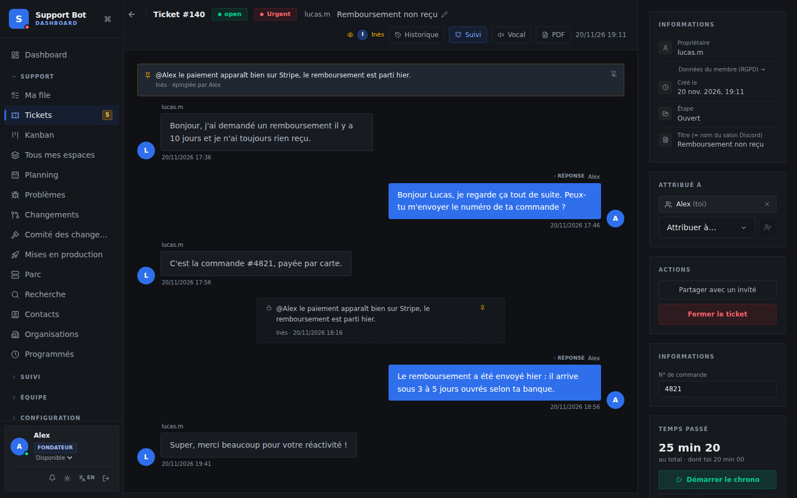
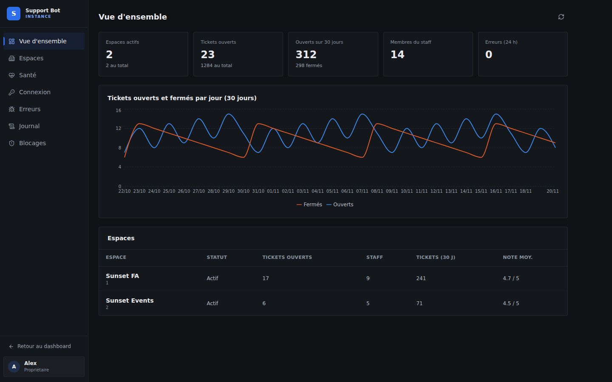
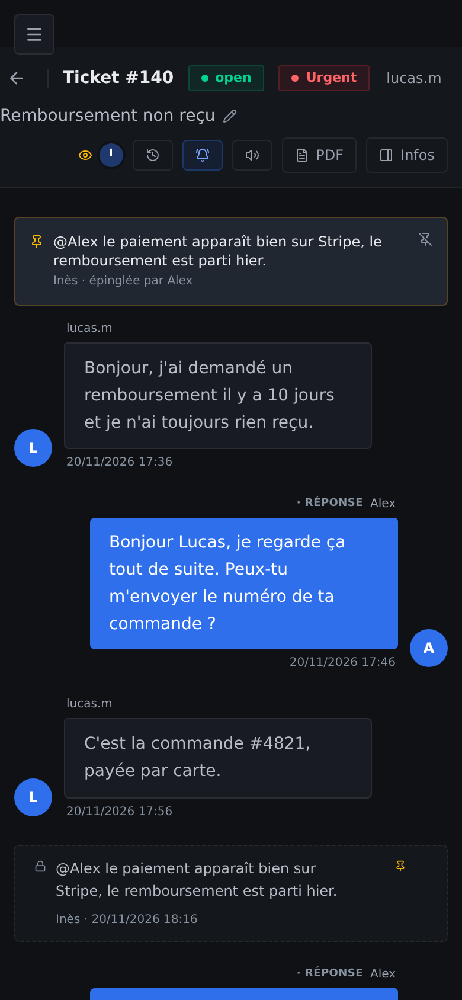

<div align="center">

# Datick

*Anciennement Ticket Bot.*

**Le support Discord par messages privés, piloté depuis un dashboard web.**
Tu installes ton instance, tu branches ton bot Discord : il est à toi.


**[Documentation](https://docs.bot.daryu.xyz)** · **[English docs](https://docs.bot.daryu.xyz/en/)** · **[Installer](https://docs.bot.daryu.xyz/guide/installation)** · **[Démo](https://ticket.sunset-fa.fr/demo)** · **[Releases](https://github.com/LuquyPest/datick/releases)**


</div>

## Comment ça marche

Un membre écrit au bot en **message privé** ; sa demande devient un **ticket**, avec un salon (ou un fil) privé côté staff. Le staff répond depuis Discord ou depuis le **dashboard**, en temps réel ; le membre reçoit tout en MP et peut aussi suivre ses tickets sur un **espace web**. Un même bot sert plusieurs serveurs Discord, chacun avec sa base, ses réglages et son équipe.

<table>
  <tr>
    <td width="50%"><p align="center"><sub><b>Fiche ticket</b> — conversation, notes internes, attribution, suivi, temps passé</sub></p></td>
    <td width="50%"><p align="center"><sub><b>Vue fractionnée</b> — la liste et le ticket côte à côte</sub></p></td>
  </tr>
  <tr>
    <td width="50%"><p align="center"><sub><b>Section Instance</b> — tes serveurs, la santé du bot, les erreurs</sub></p></td>
    <td width="50%"><p align="center"><sub><b>Espace membre</b> — le membre suit et répond à ses tickets</sub></p></td>
  </tr>
  <tr>
    <td width="50%"><p align="center"><sub><b>Thème clair</b> — et une interface « Classique » au choix</sub></p></td>
    <td width="50%" align="center"><p align="center"><sub><b>Sur téléphone</b></sub></p></td>
  </tr>
</table>

## Fonctionnalités

- **Tickets** : sujets en catégories et sous-catégories, formulaires d'ouverture, FAQ proposée avant d'ouvrir et base de connaissances publique, priorités, étapes et statuts personnalisés, Kanban, tags, notes internes, validations (accord du staff ou d'un responsable par e-mail), modèles de réponse et macros, fusion, transcripts, notation en fin de ticket ; sur Discord en salons, en fils privés, ou sans aucun salon (tout dans le dashboard).
- **Équipe** : grades et permissions fines, rôles rattachés à des tags (tickets visibles d'eux seuls), tickets confidentiels, équipes avec leur file et attribution automatique (tour à tour, selon la charge), file personnelle, absences, objectifs, statistiques, rapports PDF et statistiques publiques dans un salon.
- **Membres** : réponses en MP, commandes Discord et espace web dans leur langue — et le staff aussi dans la sienne (français, anglais, espagnol, allemand, italien, portugais) ; espace web pour suivre et ouvrir des tickets. [Aider à traduire](https://docs.bot.daryu.xyz/guide/traduire).
- **Automatismes** : rappels, escalade, inactivité, délais par étape (SLA), messages programmés, rapport hebdomadaire et mensuel, incidents annoncés aux membres.
- **Intégrations** : tickets par e-mail (IMAP/SMTP, plusieurs adresses routées vers un sujet ou une équipe, pièces jointes gardées), widget web à coller sur un site, API publique documentée (v1 et v2), webhooks sortants, panels Discord à boutons, notifications push, reprise des tickets ouverts d'un autre bot (Ticket Tool, Tickets…).
- **Sécurité** : 2FA (imposable par serveur), transcripts et secrets chiffrés, journal de toutes les actions, alerte de nouvel appareil, allowlist IP, déconnexion après inactivité.
- **Instance** : réservée au propriétaire du bot (le propriétaire de l'application Discord) — serveurs, fondateurs, santé, erreurs et alertes, journal, sauvegardes vérifiées, mise à jour en un clic, métriques Prometheus, moyens de connexion (Discord, Google, Microsoft, OpenID Connect, e-mail et mot de passe).

## Installer

Il faut un serveur avec Docker, un nom de domaine et une [application Discord](https://discord.com/developers/applications).

```bash
git clone https://github.com/LuquyPest/datick.git && cd datick
scripts/setup.sh                              # quelques questions (FR ou EN) → .env complet, secrets générés
docker compose pull && docker compose up -d
```

Ensuite, connecte-toi sur ton domaine avec le compte Discord propriétaire de l'application et invite le bot : le serveur est prêt dès son arrivée, et `/setup` sur Discord règle l'essentiel en trois clics. Avec Portainer, Coolify, Unraid ou CasaOS : [un seul fichier compose](https://docs.bot.daryu.xyz/guide/outils). Le guide pas à pas, du portail Discord au premier ticket : **[le guide d'installation](https://docs.bot.daryu.xyz/guide/installation)** (*[English](https://docs.bot.daryu.xyz/en/installation)*).

| | |
|---|---|
| Mise à jour | `docker compose pull && docker compose up -d`, ou un bouton dans le dashboard — migrations automatiques ([Mises à jour](https://docs.bot.daryu.xyz/guide/mise-a-jour)) |
| Sauvegarde | chaque nuit dans `backups/`, **chiffrée** (AES-256 + contrôle d'intégrité), vérifiée chaque semaine, copiable hors du serveur (S3, B2, SFTP…) ; restauration de tout ou d'un seul serveur, depuis le dashboard ou `scripts/restore.sh` |
| HTTPS | Caddy inclus (Let's Encrypt), ou ton Traefik, ou ton propre proxy |
| Configuration | tout dans `.env`, chaque variable est commentée dans [.env.example](.env.example) |

## Développer

Node 22, discord.js 14, Express 5, MariaDB 11 (une base par serveur Discord), Redis 7, React 19, Vite, Tailwind 4.

```bash
npm run test:integration                                  # 1292 vérifications sur MariaDB + Redis jetables
cd dashboard && npx vite build && node tests/smoke.mjs    # pages du dashboard + accessibilité (axe-core)
```

La CI rejoue les deux à chaque push ; un tag `vX.Y` (`scripts/release.sh`) publie l'image et la release. Règles du dépôt : [CONTRIBUTING.md](CONTRIBUTING.md). Faille de sécurité : [SECURITY.md](SECURITY.md).

## Licence

L'auteur fait tourner sa propre instance, démonstration comprise : [ticket.sunset-fa.fr/demo](https://ticket.sunset-fa.fr/demo). Ton installation ne lui parle jamais (seule la recherche de nouvelles versions interroge GitHub, et `UPDATE_CHECK=off` la coupe).

[AGPL-3.0](LICENSE) : libre d'installer, de modifier et d'héberger pour d'autres, à condition de publier ses modifications sous la même licence.
