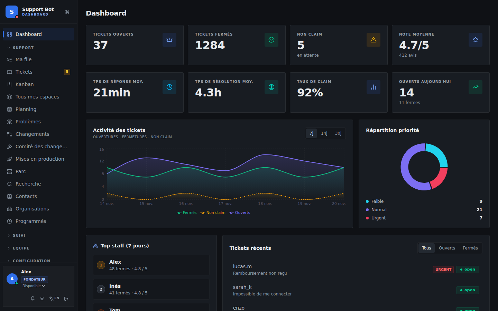
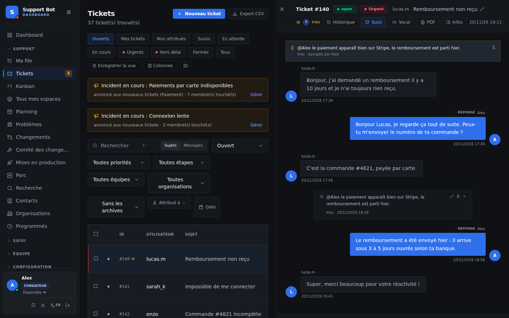
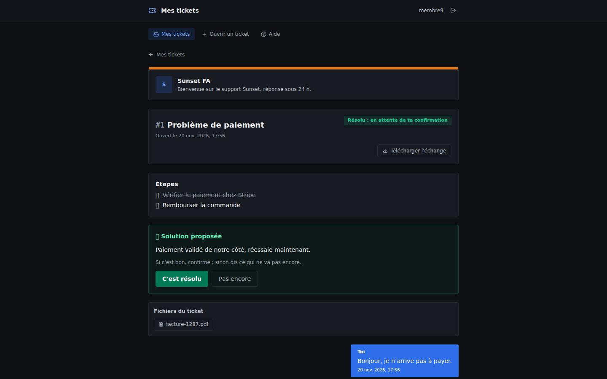
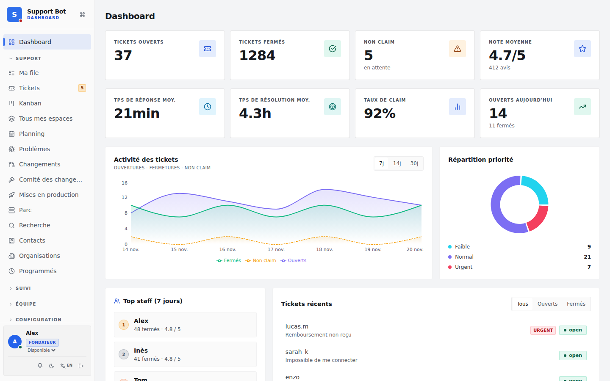

<div align="center">

# Datick

**Un système de tickets complet, à héberger soi-même.**
Discord, e-mail, formulaire web, API : chaque demande devient un ticket, traité par ton équipe depuis un seul dashboard.

*Anciennement Ticket Bot : depuis la v4, Discord n'est plus qu'un canal parmi d'autres, et il est facultatif.*


**[Documentation](https://docs.bot.daryu.xyz)** · **[English docs](https://docs.bot.daryu.xyz/en/)** · **[Installer](https://docs.bot.daryu.xyz/guide/installation)** · **[Démo](https://ticket.sunset-fa.fr/demo)** · **[Releases](https://github.com/LuquyPest/datick/releases)**



</div>

## Comment ça marche

Les demandes arrivent par le canal que la personne préfère, et ton équipe les traite toutes au même endroit :

| Canal | La personne… | Elle reçoit les réponses… |
|---|---|---|
| **Discord** | écrit au bot en message privé, ou clique sur un panel | en MP |
| **E-mail** | écrit à ton adresse de support (plusieurs adresses possibles, chacune vers un sujet ou une équipe) | par e-mail, dans le même fil |
| **Web** | ouvre un ticket depuis l'espace membre ou le widget collé sur ton site | par e-mail, avec un lien pour suivre et répondre |
| **API** | — ton propre outil crée et lit les tickets (API REST documentée, webhooks) | selon ton intégration |

Côté équipe, tout se passe dans le **dashboard web temps réel** : files par équipe, attribution automatique, statuts personnalisés, délais (SLA), validations, base de connaissances, rapports. Une même personne qui écrit sur Discord puis par e-mail n'a qu'**une fiche contact**. Une instance sert plusieurs **espaces** (une marque, un client, un serveur Discord…), chacun avec sa base, ses réglages et son équipe — un espace peut exister **sans aucun serveur Discord**.

<table>
  <tr>
    <td width="50%"><p align="center"><sub><b>Fiche ticket</b> — conversation, notes internes, attribution, suivi, temps passé</sub></p></td>
    <td width="50%"><p align="center"><sub><b>Vue fractionnée</b> — la liste et le ticket côte à côte</sub></p></td>
  </tr>
  <tr>
    <td width="50%"><p align="center"><sub><b>Section Instance</b> — tes serveurs, la santé du bot, les erreurs</sub></p></td>
    <td width="50%"><p align="center"><sub><b>Espace membre</b> — le membre suit et répond à ses tickets</sub></p></td>
  </tr>
  <tr>
    <td width="50%"><p align="center"><sub><b>Thème clair</b> — et une interface « Classique » au choix</sub></p></td>
    <td width="50%" align="center"><p align="center"><sub><b>Sur téléphone</b></sub></p></td>
  </tr>
</table>

## Fonctionnalités

- **Canaux** : Discord (MP, panels, salons ou fils privés, ou aucun salon), e-mail (Gmail et Microsoft 365 par OAuth, IMAP/SMTP, ou réception par webhook Mailgun, Postmark, SendGrid, SES ; copies (Cc) gardées, réponses en HTML signées, anti-spam et quarantaine ; plusieurs adresses routées vers un sujet ou une équipe, pièces jointes gardées), espace membre web (connexion Discord ou par lien e-mail), widget à coller sur un site, API publique (v1, v2 et v3 en écriture) et webhooks ; une fiche contact par personne, quel que soit le canal.
- **Tickets** : tâches (personne, durée prévue, temps passé, modèles) et planning par personne ou équipe avec flux iCal, éditeur de réponses avec mise en forme et raccourcis, colonnes et vues d'équipe, coûts (taux horaires, forfaits, frais, rapports par organisation), problèmes (cause commune, contournement, résolution groupée) et changements (plans, risques, validations, créneau), catalogue de services (formulaires à champs conditionnels, gabarits), organisations (contacts regroupés par domaine, SLA et horaires propres, sous-organisations, leurs tickets visibles dans l'espace membre), types (incident ou demande), résolution confirmée par le demandeur et clôture automatique, priorité urgence × impact, sujets en catégories et sous-catégories, formulaires d'ouverture, FAQ proposée avant d'ouvrir et base de connaissances publique, priorités, étapes et statuts personnalisés, Kanban, tags, notes internes, validations (accord du staff ou d'un responsable par e-mail), modèles de réponse et macros, fusion, transcripts, enquête de satisfaction (délai, questions, lien externe, taux de réponse) ; base de connaissances gérée (brouillons, visibilités, versions, traductions, avis des lecteurs, pages référencées sans JavaScript) ; sur Discord en salons, en fils privés, ou sans aucun salon (tout dans le dashboard).
- **Équipe** : grades et permissions fines, rôles rattachés à des tags (tickets visibles d'eux seuls), tickets confidentiels, équipes avec leur file et attribution automatique (tour à tour, selon la charge), file personnelle, absences, objectifs, statistiques, rapports par équipe, catégorie et canal (export CSV), rapports PDF et statistiques publiques dans un salon.
- **Demandeurs** : réponses en MP, par e-mail ou sur l'espace web, dans leur langue — et le staff aussi dans la sienne (français, anglais, espagnol, allemand, italien, portugais) ; espace web pour suivre et ouvrir des tickets. [Aider à traduire](https://docs.bot.daryu.xyz/guide/traduire).
- **Pilotage** : tableaux de bord personnels ou partagés (compteurs, courbes, listes, SLA, satisfaction, filtres) ; rapports sur période libre, par organisation, personne, priorité, en CSV, XLSX ou PDF, programmés par e-mail.
- **Automatismes** : tickets récurrents (chaque jour, semaine ou mois), notifications configurables (événements, destinataires, canaux dont Slack et Microsoft Teams avec le bouton « Prendre », préférences de chacun, messages au demandeur par langue), règles automatiques (quand, si, alors, dans l'ordre, avec test et journal, y compris « quand le temps passe » en heures ouvrées), horaires d'ouverture et jours fériés (réponse hors horaires), rappels, escalade, inactivité, objectifs SLA en heures ouvrées (prise en charge, résolution, par priorité, type, sujet ou canal) avec escalade par niveaux, objectifs internes par équipe (OLA), délais par étape, messages programmés, rapport hebdomadaire et mensuel, incidents annoncés aux membres.
- **Intégrations** : webhooks sortants, notifications push, export et import de configuration, reprise des tickets ouverts d'un autre bot Discord (Ticket Tool, Tickets…), import depuis Zendesk, Freshdesk, GLPI, osTicket, Zammad ou un CSV.
- **Sécurité** : 2FA (imposable par serveur), transcripts et secrets chiffrés, journal de toutes les actions, alerte de nouvel appareil, allowlist IP, déconnexion après inactivité ; RGPD : tickets clos anonymisés ou supprimés après N mois, archives, export et effacement des données d'un demandeur.
- **Instance** : réservée à son propriétaire — espaces (avec ou sans Discord), fondateurs, santé, erreurs et alertes, journal, sauvegardes vérifiées, mise à jour en un clic, métriques Prometheus, moyens de connexion (Discord, Google, Microsoft, OpenID Connect, annuaire LDAP / Active Directory, e-mail et mot de passe).

## Installer

Il faut un serveur avec Docker et un nom de domaine. Une [application Discord](https://discord.com/developers/applications) n'est utile que si tu veux le canal Discord.

```bash
git clone https://github.com/LuquyPest/datick.git && cd datick
scripts/setup.sh                              # quelques questions (FR ou EN) → .env complet, secrets générés
docker compose pull && docker compose up -d
```

Ensuite, ouvre ton domaine : connecte-toi avec le compte Discord propriétaire de l'application, ou, sans Discord, crée le compte propriétaire sur la page d'installation dont `setup.sh` t'a donné l'adresse. Crée un espace (Instance → Serveurs), branche une adresse e-mail ou colle le widget sur ton site ; avec Discord, invite le bot et le serveur est prêt dès son arrivée (`/setup` règle l'essentiel en trois clics). Avec Portainer, Coolify, Unraid ou CasaOS : [un seul fichier compose](https://docs.bot.daryu.xyz/guide/outils). Le guide pas à pas, du portail Discord au premier ticket : **[le guide d'installation](https://docs.bot.daryu.xyz/guide/installation)** (*[English](https://docs.bot.daryu.xyz/en/installation)*).

| | |
|---|---|
| Mise à jour | `docker compose pull && docker compose up -d`, ou un bouton dans le dashboard — migrations automatiques ([Mises à jour](https://docs.bot.daryu.xyz/guide/mise-a-jour)) |
| Sauvegarde | chaque nuit dans `backups/`, **chiffrée** (AES-256 + contrôle d'intégrité), vérifiée chaque semaine, copiable hors du serveur (S3, B2, SFTP…) ; restauration de tout ou d'un seul serveur, depuis le dashboard ou `scripts/restore.sh` |
| HTTPS | Caddy inclus (Let's Encrypt), ou ton Traefik, ou ton propre proxy |
| Configuration | tout dans `.env`, chaque variable est commentée dans [.env.example](.env.example) |

## Développer

Node 22, discord.js 14, Express 5, MariaDB 11 (une base par espace), Redis 7, React 19, Vite, Tailwind 4.

```bash
npm run test:integration                                  # 1848 vérifications sur MariaDB + Redis jetables
cd dashboard && npx vite build && node tests/smoke.mjs    # pages du dashboard + accessibilité (axe-core)
```

La CI rejoue les deux à chaque push ; un tag `vX.Y` (`scripts/release.sh`) publie l'image et la release. Règles du dépôt : [CONTRIBUTING.md](CONTRIBUTING.md). Faille de sécurité : [SECURITY.md](SECURITY.md).

## Licence

L'auteur fait tourner sa propre instance, démonstration comprise : [ticket.sunset-fa.fr/demo](https://ticket.sunset-fa.fr/demo). Ton installation ne lui parle jamais (seule la recherche de nouvelles versions interroge GitHub, et `UPDATE_CHECK=off` la coupe).

[AGPL-3.0](LICENSE) : libre d'installer, de modifier et d'héberger pour d'autres, à condition de publier ses modifications sous la même licence.
