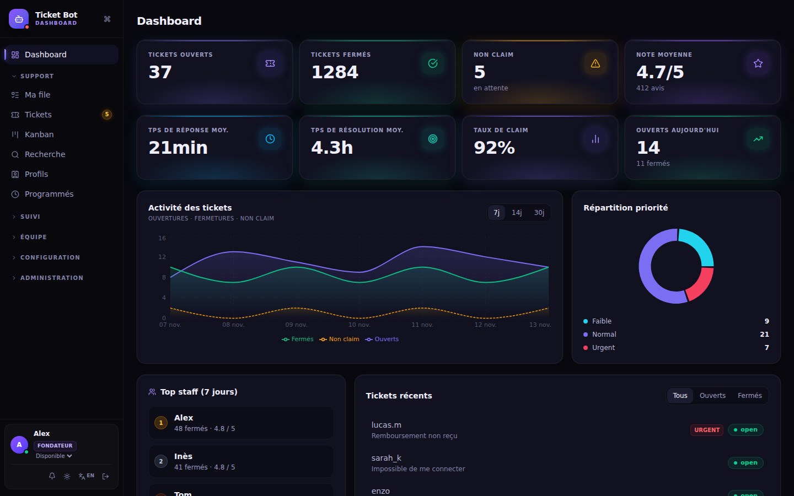
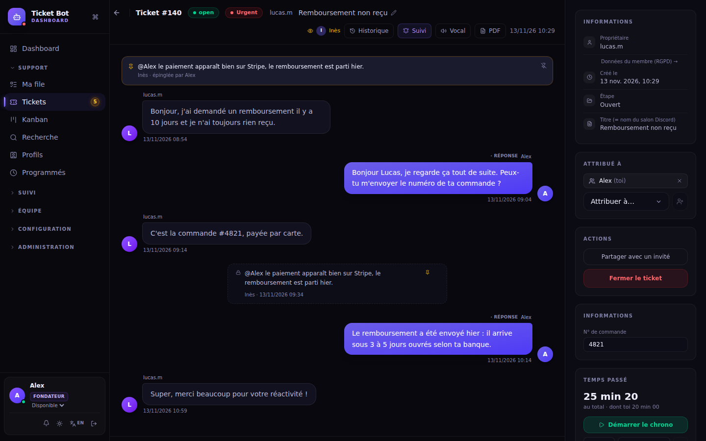
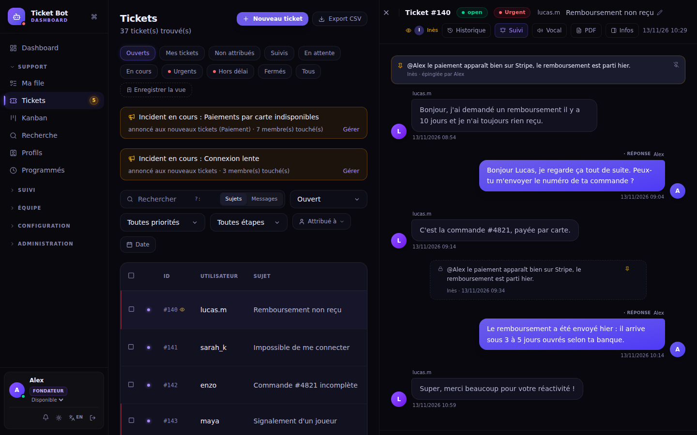
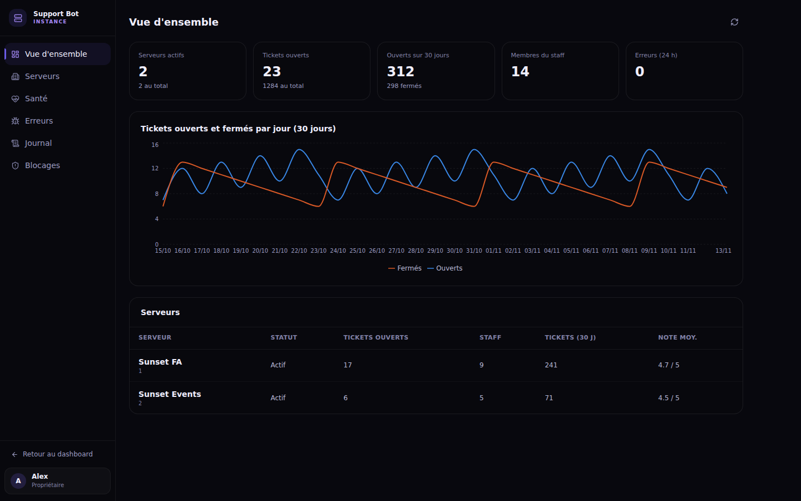
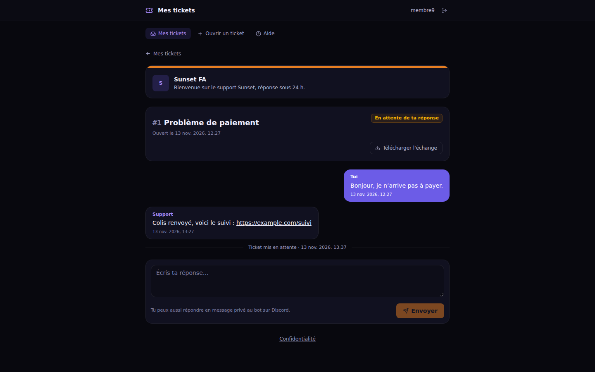
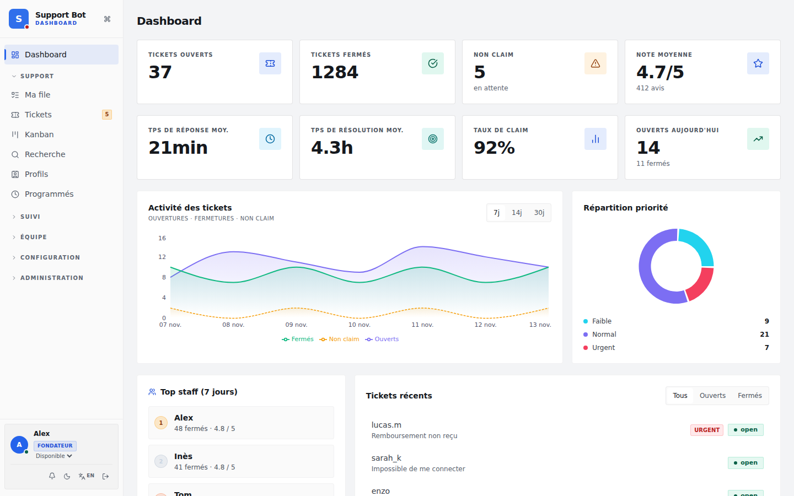
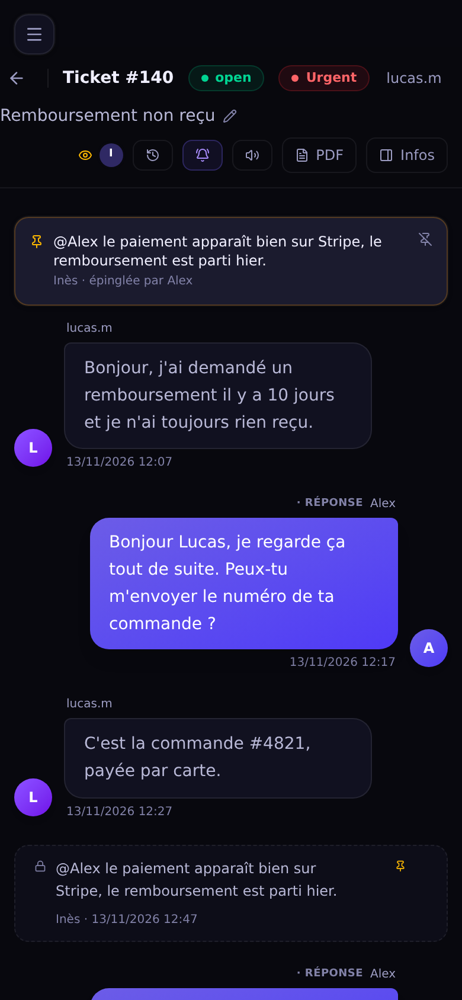

<div align="center">

# Ticket Bot

**Le support Discord par messages privés, piloté depuis un dashboard web.**
Tu installes ton instance, tu branches ton bot Discord : il est à toi.


**[Installer](INSTALL.md)** · **[Mettre à jour](UPGRADE.md)** · **[Releases](https://github.com/LuquyPest/Bot-ticketting/releases)** · **[Contribuer](CONTRIBUTING.md)**



</div>

## Comment ça marche

Un membre écrit au bot en **message privé** ; sa demande devient un **ticket**, avec un salon (ou un fil) privé côté staff. Le staff répond depuis Discord ou depuis le **dashboard**, en temps réel ; le membre reçoit tout en MP et peut aussi suivre ses tickets sur un **espace web**. Un même bot sert plusieurs serveurs Discord, chacun avec sa base, ses réglages et son équipe.

<table>
  <tr>
    <td width="50%"><p align="center"><sub><b>Fiche ticket</b> — conversation, notes internes, attribution, suivi, temps passé</sub></p></td>
    <td width="50%"><p align="center"><sub><b>Vue fractionnée</b> — la liste et le ticket côte à côte</sub></p></td>
  </tr>
  <tr>
    <td width="50%"><p align="center"><sub><b>Section Instance</b> — tes serveurs, la santé du bot, les erreurs</sub></p></td>
    <td width="50%"><p align="center"><sub><b>Espace membre</b> — le membre suit et répond à ses tickets</sub></p></td>
  </tr>
  <tr>
    <td width="50%"><p align="center"><sub><b>Thème clair</b> — et une interface « Classique » au choix</sub></p></td>
    <td width="50%" align="center"><p align="center"><sub><b>Sur téléphone</b></sub></p></td>
  </tr>
</table>

## Fonctionnalités

- **Tickets** : sujets, formulaires d'ouverture, FAQ proposée avant d'ouvrir, priorités, étapes et Kanban, tags, notes internes, modèles de réponse et macros, fusion, transcripts, notation en fin de ticket.
- **Équipe** : grades et permissions fines, rôles rattachés à des tags (tickets visibles d'eux seuls), tickets confidentiels, file personnelle, absences, objectifs, statistiques et rapports PDF.
- **Automatismes** : rappels, escalade, inactivité, délais par étape (SLA), messages programmés, rapport hebdomadaire et mensuel, incidents annoncés aux membres.
- **Intégrations** : API publique documentée, webhooks sortants, panels Discord à boutons, notifications push.
- **Sécurité** : 2FA (imposable par serveur), transcripts et secrets chiffrés, journal de toutes les actions, alerte de nouvel appareil, allowlist IP, déconnexion après inactivité.
- **Instance** : réservée au propriétaire du bot (le propriétaire de l'application Discord) — serveurs, fondateurs, santé, erreurs et alertes, journal. Pas de compte à créer : connexion Discord.

## Installer

Il faut un serveur avec Docker, un nom de domaine et une [application Discord](https://discord.com/developers/applications).

```bash
git clone https://github.com/LuquyPest/Bot-ticketting.git && cd Bot-ticketting
scripts/setup.sh                              # quelques questions → .env complet, secrets générés
docker compose pull && docker compose up -d
```

Ensuite, connecte-toi sur ton domaine avec le compte Discord propriétaire de l'application et invite le bot : le serveur est prêt dès son arrivée. Le guide pas à pas, du portail Discord au premier ticket : **[INSTALL.md](INSTALL.md)** (*[English](INSTALL.en.md)*).

| | |
|---|---|
| Mise à jour | `docker compose pull && docker compose up -d` — migrations automatiques ([UPGRADE.md](UPGRADE.md)) |
| Sauvegarde | chaque nuit dans `backups/` (service `backup`) ; restauration : `scripts/restore.sh` |
| HTTPS | Caddy inclus (Let's Encrypt), ou ton Traefik, ou ton propre proxy |
| Configuration | tout dans `.env`, chaque variable est commentée dans [.env.example](.env.example) |

## Développer

Node 22, discord.js 14, Express 5, MariaDB 11 (une base par serveur Discord), Redis 7, React 19, Vite, Tailwind 4.

```bash
npm run test:integration                                  # 876 vérifications sur MariaDB + Redis jetables
cd dashboard && npx vite build && node tests/smoke.mjs    # pages du dashboard + accessibilité (axe-core)
```

La CI rejoue les deux à chaque push ; un tag `vX.Y` (`scripts/release.sh`) publie l'image et la release. Règles du dépôt : [CONTRIBUTING.md](CONTRIBUTING.md). Faille de sécurité : [SECURITY.md](SECURITY.md).

## Licence

L'auteur fait tourner sa propre instance, démonstration comprise : [ticket.sunset-fa.fr](https://ticket.sunset-fa.fr/login). Ton installation ne lui parle jamais.

[AGPL-3.0](LICENSE) : libre d'installer, de modifier et d'héberger pour d'autres, à condition de publier ses modifications sous la même licence.
