<div align="center">

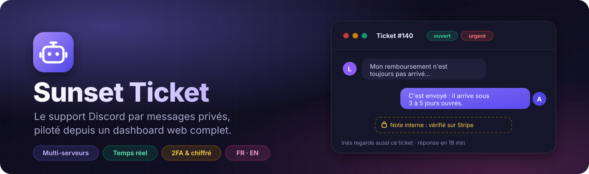

<br><br>


<br>


**[⚡ Installer le sien](INSTALL.md)** &nbsp;·&nbsp; **[Démarrage rapide](#-démarrage-rapide)** &nbsp;·&nbsp; **[Documentation](#-documentation)** &nbsp;·&nbsp; **[Releases](https://github.com/LuquyPest/Bot-ticketting/releases)**

</div>

<br>

Les membres écrivent au bot **en message privé** ; chaque demande devient un **ticket** que le staff traite depuis Discord ou depuis un **dashboard web temps réel**. Un seul bot sert **plusieurs serveurs Discord**, chacun avec sa propre base de données, ses réglages, ses grades et son équipe.

Logiciel libre ([AGPL-3.0](LICENSE)) : **chacun héberge le sien**, en vingt minutes avec Docker, sans dépendre de personne — voir [INSTALL.md](INSTALL.md).

<br>

## ✨ Aperçu

<p align="center">
  
</p>

<table>
  <tr>
    <td width="50%" valign="top">
      
      <p align="center"><b>Fiche ticket</b><br><sub>Conversation, notes internes épinglées, collègues présents, suivi, vocal, temps passé, procédures</sub></p>
    </td>
    <td width="50%" valign="top">
      
      <p align="center"><b>Vue fractionnée</b><br><sub>La liste à gauche, le ticket à droite, sans changer de page</sub></p>
    </td>
  </tr>
  <tr>
    <td width="50%" valign="top">
      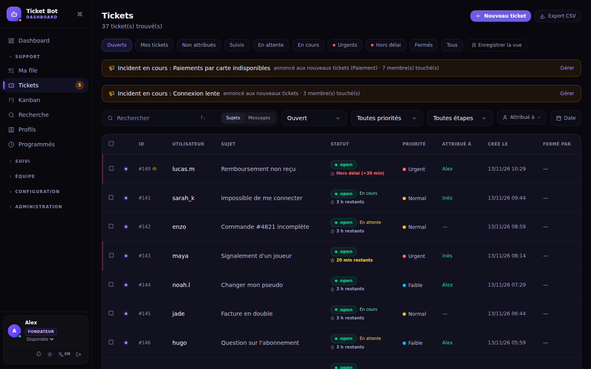
      <p align="center"><b>Tickets</b><br><sub>Vues prêtes ou enregistrées, recherche avec opérateurs (<code>tag:</code> <code>de:</code> <code>étape:</code>…), actions en masse</sub></p>
    </td>
    <td width="50%" valign="top">
      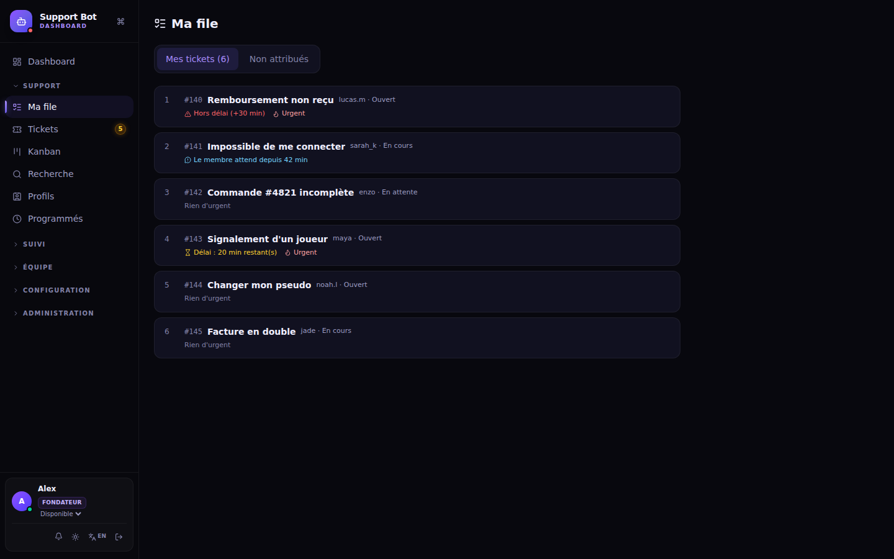
      <p align="center"><b>Ma file</b><br><sub>Ses tickets du plus urgent au moins urgent, avec la raison</sub></p>
    </td>
  </tr>
  <tr>
    <td width="50%" valign="top">
      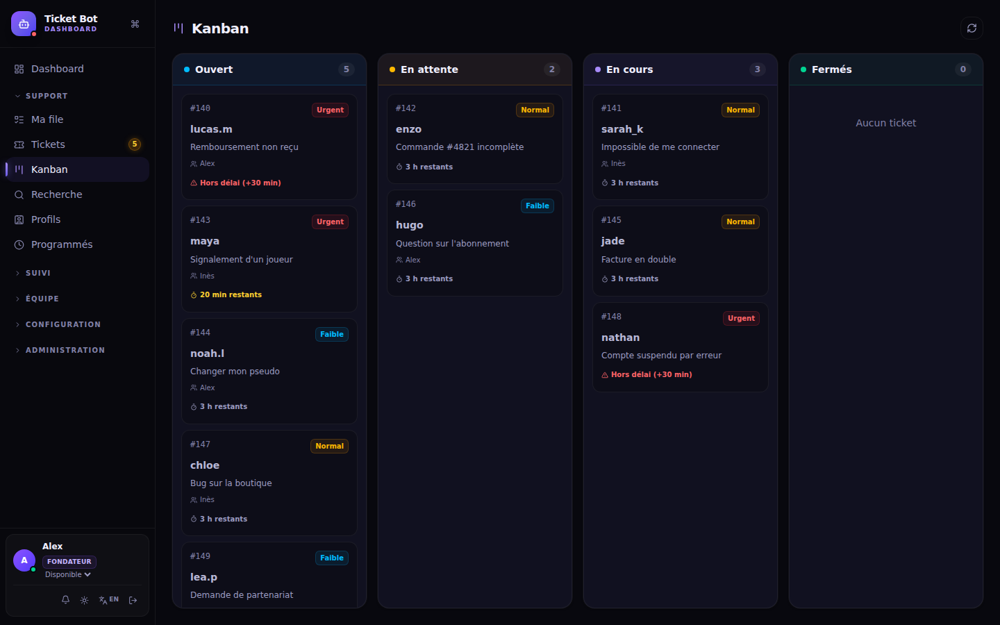
      <p align="center"><b>Kanban</b><br><sub>Ouvert, en attente, en cours : délais visibles sur chaque carte</sub></p>
    </td>
    <td width="50%" valign="top">
      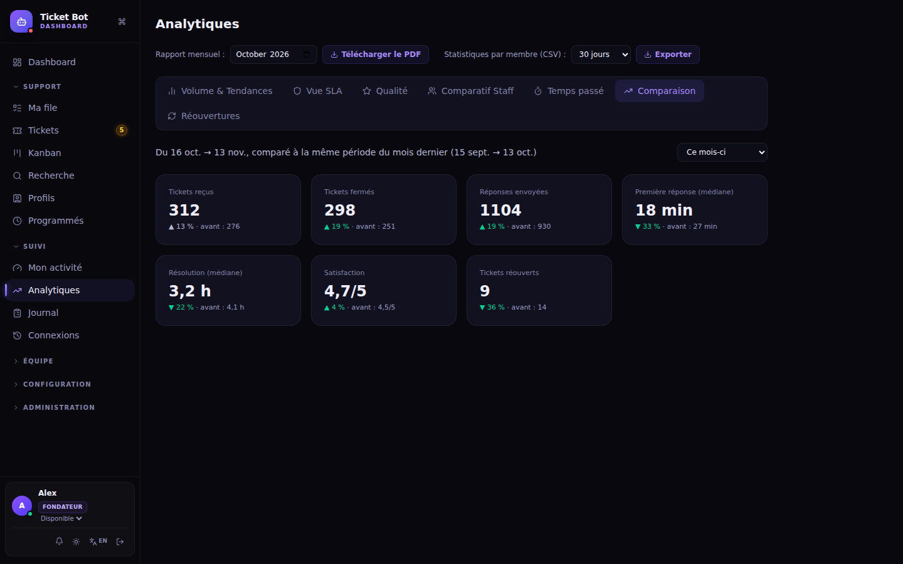
      <p align="center"><b>Analytique</b><br><sub>Comparaison avec la période précédente, réouvertures, qualité, SLA, exports CSV et PDF</sub></p>
    </td>
  </tr>
  <tr>
    <td width="50%" valign="top">
      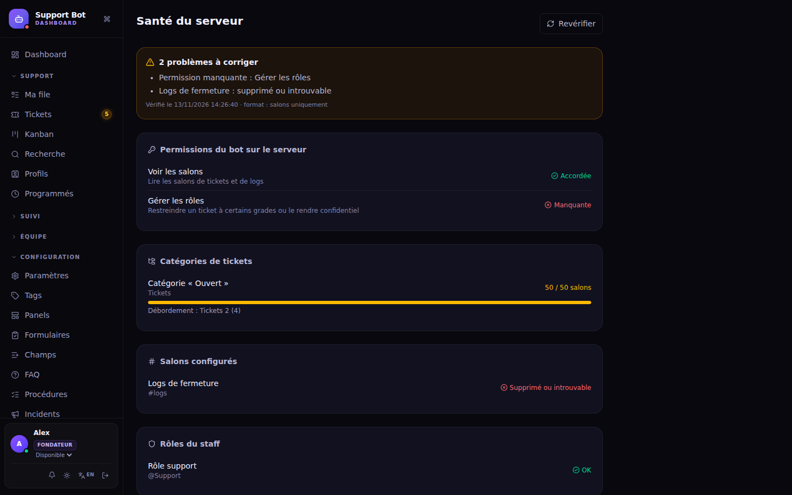
      <p align="center"><b>Santé du serveur</b><br><sub>Permissions du bot, salons et rôles introuvables, catégories pleines — et MP dès qu'un problème apparaît</sub></p>
    </td>
    <td width="50%" valign="top">
      
      <p align="center"><b>Espace membre</b><br><sub>Les membres retrouvent leurs tickets, répondent et ouvrent une demande depuis le web</sub></p>
    </td>
  </tr>
  <tr>
    <td width="50%" valign="top">
      
      <p align="center"><b>Thème clair</b><br><sub>Sombre ou clair, en français ou en anglais</sub></p>
    </td>
    <td width="50%" valign="top">
      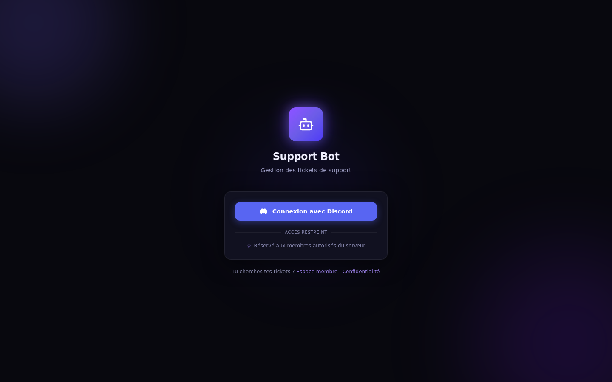
      <p align="center"><b>Connexion Discord</b><br><sub>OAuth2, double authentification, au nom et à l'avatar de ton bot</sub></p>
    </td>
  </tr>
</table>

<h3 align="center">Section Instance</h3>

<p align="center">
  
</p>
<p align="center"><sub>Réservée au propriétaire du bot : ses serveurs, leurs fondateurs, la santé, les erreurs, le journal — avec sa connexion Discord</sub></p>

<h3 align="center">Interface « Pro »</h3>
<p align="center"><sub>Au choix dans le profil : la même application, en palette neutre, angles droits, sans effets. Sombre ou clair.</sub></p>
<p align="center">
  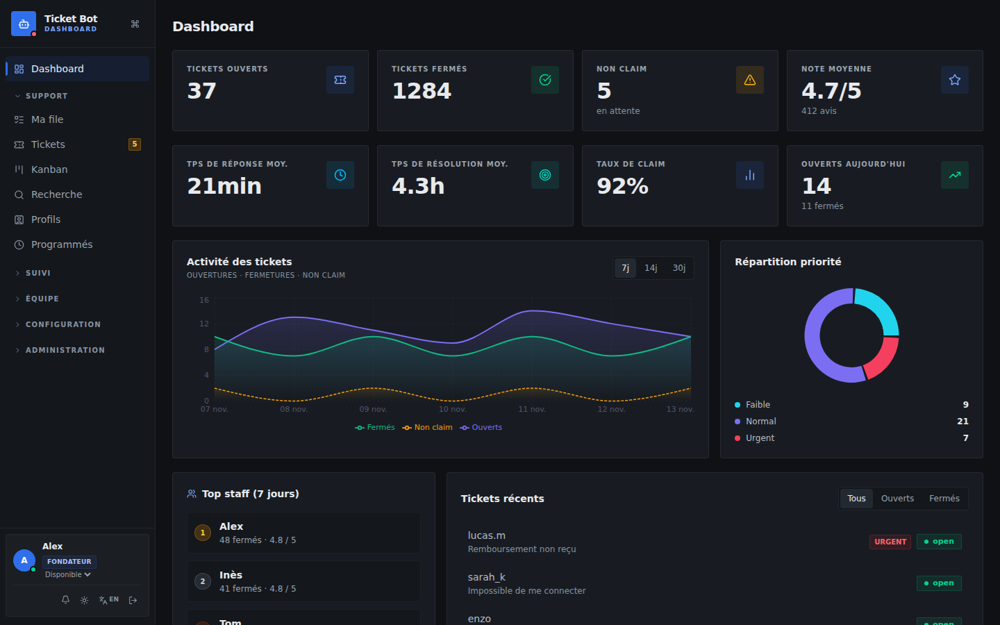
</p>
<table>
  <tr>
    <td width="50%" valign="top">
      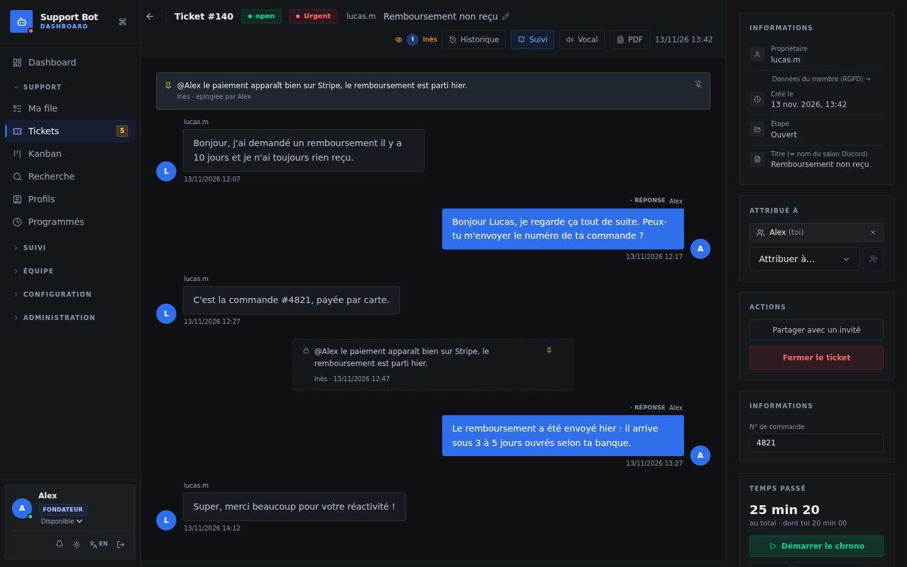
      <p align="center"><b>Fiche ticket</b></p>
    </td>
    <td width="50%" valign="top">
      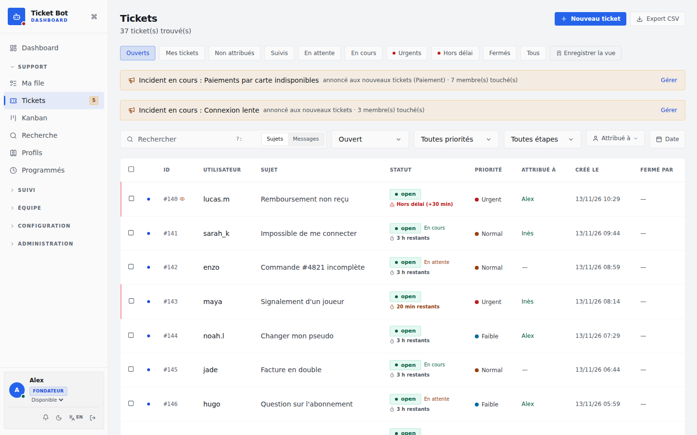
      <p align="center"><b>Liste des tickets, mode clair</b></p>
    </td>
  </tr>
</table>

<table>
  <tr>
    <td width="230" valign="top"></td>
    <td valign="top">
      <h3>📱 Aussi sur téléphone</h3>
      Le dashboard et l'espace membre s'adaptent à toutes les largeurs : chaque page est vérifiée automatiquement à 390 px de large (aucun défilement horizontal) et passée à <b>axe-core</b> (WCAG 2.1 AA) en thème sombre et clair.
      <br><br>
      Les notifications du navigateur préviennent d'une attribution, d'une mention ou d'un ticket suivi, même onglet fermé.
    </td>
  </tr>
</table>

<br>

## 🚀 Ce qu'il sait faire

<table>
  <tr>
    <th width="33%">💬 Pour les membres</th>
    <th width="33%">🛠️ Pour le staff</th>
    <th width="33%">👑 Pour les fondateurs</th>
  </tr>
  <tr>
    <td valign="top">
      <ul>
        <li>Un ticket en écrivant au bot en MP, ou d'un clic sur un <b>panel</b></li>
        <li>Sujets, formulaires, champs (n° de commande…)</li>
        <li><b>FAQ automatique</b> qui répond avant d'ouvrir un ticket</li>
        <li>Demande <b>confidentielle</b>, vue des seuls fondateurs</li>
        <li>Plusieurs tickets et plusieurs serveurs à la fois</li>
        <li><b>Espace membre</b> web, transcript téléchargeable</li>
        <li>Notation, réouverture, messages en <b>français ou anglais</b></li>
      </ul>
    </td>
    <td valign="top">
      <ul>
        <li><b>Ma file</b>, Kanban, vues, recherche avec opérateurs</li>
        <li>Modèles et <b>macros</b>, aperçu Discord, captures collées</li>
        <li>Réponses <b>corrigées ou retirées</b> chez le membre</li>
        <li>Notes internes, <b>@collègue</b> et <b>@grade</b>, suivi de tickets</li>
        <li>Délais par étape, chronomètre, procédures à cocher</li>
        <li><b>Temps réel</b> : qui regarde, qui écrit, anti double réponse</li>
        <li>Salon <b>vocal</b> temporaire, ticket ouvert vers un membre</li>
      </ul>
    </td>
    <td valign="top">
      <ul>
        <li><b>Grades</b> et permissions fines, visibilité par grade</li>
        <li><b>Journal</b> de toutes les actions, consultations confidentielles</li>
        <li>Analytique, comparaison de périodes, <b>exports</b> CSV / PDF</li>
        <li><b>Santé du serveur</b>, catégories qui débordent, salons ou fils</li>
        <li>Absences planifiées, <b>visite guidée</b> des nouveaux</li>
        <li>Accès <b>invités</b> temporaires, API publique, webhooks</li>
        <li>Configuration exportable, avec historique et retour arrière</li>
      </ul>
    </td>
  </tr>
</table>

**🔐 Sécurité** — 2FA (TOTP + codes de secours), transcripts et secrets chiffrés (AES-256-GCM, rotation de clé), alerte de connexion depuis un nouvel appareil, déconnexion après inactivité, allowlist IP, CSRF, limites anti-abus, isolation stricte entre serveurs. Détails dans [Sécurité](#sécurité).

<br>

## 🔄 Comment ça marche

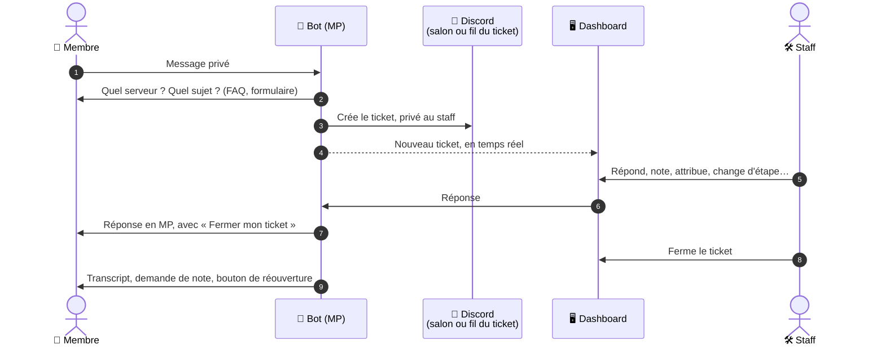

## 🧱 Architecture

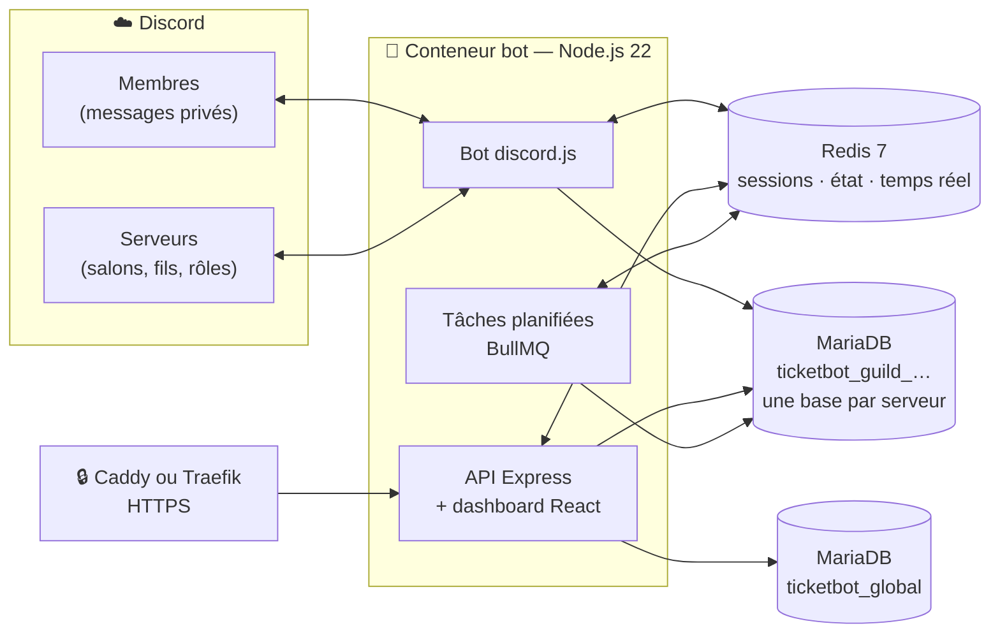

Un serveur Discord qui ajoute le bot est enregistré dans `ticketbot_global` et actif aussitôt, avec sa base de données dédiée. Le propriétaire de l'application Discord administre l'instance depuis la section **Instance** du dashboard. Un serveur suspendu ou en maintenance est ignoré par le bot.

<br>

## ⚡ Démarrage rapide

```bash
git clone https://github.com/LuquyPest/Bot-ticketting.git && cd Bot-ticketting
scripts/setup.sh                         # token Discord, domaine, e-mail → .env complet, secrets générés
docker compose pull && docker compose up -d
```

Il faut un serveur avec Docker, un nom de domaine et une application Discord. Le guide pas à pas, du portail Discord au premier serveur activé : **[INSTALL.md](INSTALL.md)** (*[English](INSTALL.en.md)*). Mise à jour : `docker compose pull && docker compose up -d` ([UPGRADE.md](UPGRADE.md)).

<br>

## 📚 Documentation

<table><tr><td valign="top">

- [Architecture](#-architecture)
- [Stack technique](#stack-technique)
- [Fonctionnement — cycle de vie d'un ticket](#fonctionnement--cycle-de-vie-dun-ticket)
- [Installation](#installation)
- [Configuration](#configuration)
- [Serveur de démonstration](#serveur-de-démonstration)
- [Arrivée d'un serveur](#arrivée-dun-serveur)
- [Dashboard web](#dashboard-web)
- [Section Instance](#section-instance)
- [Commandes Discord](#commandes-discord)
- [Fonctionnalités avancées](#fonctionnalités-avancées)

</td><td valign="top">

- [Panels Discord](#panels-discord)
- [Push Notifications Web](#push-notifications-web)
- [Gestion des sessions](#gestion-des-sessions)
- [Webhooks sortants](#webhooks-sortants)
- [API Keys](#api-keys)
- [Base de données](#base-de-données)
- [Structure des fichiers](#structure-des-fichiers)
- [Sécurité](#sécurité)
- [Rotation de la clé de chiffrement](#rotation-de-la-clé-de-chiffrement)
- [Migrations des bases](#migrations-des-bases)
- [Tests](#tests)
- [Problèmes fréquents](#problèmes-fréquents)
- [Instance de l'auteur](#instance-de-lauteur)
- [Licence et contributions](#licence-et-contributions)

</td></tr></table>

---

## Stack technique

| Couche | Technologies |
|--------|-------------|
| Bot Discord | Node.js 22, Discord.js 14 |
| API / serveur web | Express 5, express-session, Helmet, express-rate-limit, multer (fichiers), pdfkit (rapports) |
| Base de données | MariaDB 11 (mysql2, une base par serveur, migrations versionnées, index FULLTEXT) |
| Authentification | OAuth2 Discord, TOTP 2FA (otplib), bcrypt ; secrets 2FA et transcripts chiffrés AES-256-GCM avec rotation de clé |
| Temps réel | Server-Sent Events (SSE) relayés entre instances par Redis pub/sub |
| Notifications push | Web Push API (VAPID, web-push) |
| Sessions, état & jobs | Redis 7 (sessions via connect-redis, états des conversations MP, présence, BullMQ pour les tâches planifiées) |
| Dashboard frontend | React 19, React Router 7, Vite 8, Tailwind CSS 4, Recharts 3, lucide-react |
| Tests | Suite d'intégration (vrai serveur + faux client Discord), test de fumée Playwright + axe-core, test de charge |
| Déploiement | Docker (multi-stage), Docker Compose, Traefik ; CI GitHub Actions, Dependabot |

---

## Fonctionnement — cycle de vie d'un ticket

### Côté membre

1. Le membre envoie un **message privé** au bot
2. S'il a déjà des tickets ouverts → le bot lui demande, **à chaque message**, dans quel ticket l'envoyer, ou s'il veut **ouvrir un nouveau ticket** (un membre peut avoir plusieurs tickets, dans la limite quotidienne)
3. Nouveau ticket : si le membre est dans plusieurs serveurs utilisant le bot → choix du serveur
3 bis. Si la **FAQ automatique** est activée et que le message correspond à des entrées (mots-clés, mots de la question), le bot propose jusqu'à 3 réponses avec « ✅ La réponse N m'a aidé » (aucun ticket n'est ouvert) ou « 📩 Ouvrir un ticket quand même ». Un nouveau message à ce moment ouvre aussi le ticket
4. Le bot demande ensuite le **sujet du ticket** : boutons si des sujets sont configurés (+ « Autre sujet »), sinon réponse libre. Sans réponse sous 10 minutes, le ticket est ouvert sans sujet. Les conversations en cours (sujet, choix du serveur ou du ticket, formulaire) sont gardées dans Redis : un redémarrage du bot ne fait perdre aucune réponse
**Demande confidentielle** : au moment du choix du sujet (MP) ou dans le formulaire de l'espace membre, le membre peut demander un ticket confidentiel (signalement d'un membre du staff, harcèlement…). Le ticket n'est alors visible que des **fondateurs** : liste, fiche, recherche, temps réel, notifications, commandes Discord, et salon Discord fermé au staff avant que le moindre message n'y soit posté. Le membre en est informé dans le message de bienvenue ; seul un fondateur peut lever ou poser la confidentialité (bloc « Visibilité » de la fiche), et aucune règle automatique ne la modifie. Le ticket reste aussi en dehors de ce que le staff voit ailleurs : vue SLA et répartition par sujet d'Analytique, temps passé, profil du membre (champs, notes, temps), listes du tableau de bord. Dans les salons de logs et d'alertes partagés, la fermeture et l'escalade d'un ticket confidentiel n'indiquent ni le membre ni le sujet. Rouvert, il retrouve un salon fermé au staff dès sa création (vrai aussi pour un ticket restreint à un grade) : même sans la permission « Gérer les rôles », rien ne fuit. Techniquement, le ticket porte une valeur de visibilité réservée (`-1`) qu'aucun grade ne peut avoir.

À la création, les **règles automatiques par sujet** (Paramètres → Sujets de ticket) s'appliquent : ajouter un tag, fixer une priorité, réserver le ticket à un grade (salon Discord compris). Une règle se déclenche soit par **sujet** (comparé sans accents ni majuscules : « paiement » couvre « Problème de paiement »), soit par **mots-clés** du premier message du membre (liste séparée par des virgules, comparée depuis le début des mots : « rembours » couvre « remboursé », « carte refusée » couvre « Carte Refusee »).

4 bis. Si des **champs personnalisés** sont définis (page **Champs** : n° de commande, pseudo en jeu… ; texte ou nombre, obligatoire ou non, pour tous les sujets ou un sujet précis), le bot les demande un par un ; les valeurs sont enregistrées, rappelées dans le salon, modifiables dans la fiche et utilisables comme filtre dans la liste des tickets
5. Si un **formulaire d'intake** est activé → questionnaire étape par étape avant création
6. Un salon privé est créé dans le serveur Discord, **nommé d'après le sujet**
7. Les messages et fichiers suivants sont relayés dans le ticket choisi
8. Le membre reçoit les réponses du staff en DM (embed indiquant le serveur et le ticket). Le message de bienvenue et les réponses portent un bouton **« Fermer mon ticket »** (propriétaire du ticket uniquement, avec confirmation) : le ticket est fermé avec transcript, et la fermeture n'est pas comptée dans les statistiques du staff
9. À la fermeture → le membre reçoit un **bouton de notation** (1–5 étoiles), puis peut **ajouter un commentaire** libre (1 000 caractères), visible dans la fiche du ticket. Une note basse (2 étoiles ou moins par défaut, réglable, 0 = désactivé) prévient les fondateurs et les chefs support (notification, push, MP avec le lien) ; depuis la fiche, « Recontacter le membre » lui envoie un MP (avec le bouton de réouverture s'il est encore possible) et marque le suivi comme fait. Le MP de fermeture porte aussi un bouton **« Rouvrir mon ticket »** valable quelques jours (7 par défaut, réglable dans les paramètres, 0 = désactivé) : le ticket est rouvert avec son historique, dans la limite de tickets ouverts du serveur

Le membre peut aussi ouvrir un ticket en cliquant sur un **panel** publié dans un salon (voir [Panels Discord](#panels-discord)). Un utilisateur blacklisté sur un serveur ne peut pas y ouvrir de ticket (la blacklist est propre à chaque serveur).

**Langue des messages** (Paramètres → Identité du bot) : français, anglais, ou automatique (langue Discord du membre, mémorisée à sa dernière interaction avec le bot, sinon langue du serveur). Elle s'applique à tout ce que le bot envoie aux membres : questions, bienvenue, réponses du staff (cadre et boutons), notifications, fermeture, notation, FAQ, panels. Les textes personnalisés (bienvenue, fermeture, FAQ, réponses du staff) restent tels qu'écrits ; les messages destinés au staff restent en français (le dashboard, lui, peut s'afficher en anglais : voir ci-dessous). Le message de fermeture personnalisé des paramètres est désormais bien utilisé dans le MP de fermeture.

### Côté staff

- Répond via `/reply` (identifié), `/areply` (anonyme comme "Support") ou depuis le **dashboard web** ; depuis le dashboard, un **fichier** (8 Mo max) peut être joint : il arrive en pièce jointe dans le MP du membre et dans le salon
- Les messages tapés directement dans le salon Discord sont enregistrés comme notes mais **ne sont pas envoyés** au membre
- Le staff peut aussi **contacter un membre de lui-même** (sanction, suivi, remboursement) : bouton **Nouveau ticket** de la page Tickets, `/contact`, ou clic droit sur un message d'un salon public → Applications → **Sunset-Ticket → Créer un ticket** (seul un titre est demandé ; le message d'origine est repris dans le ticket, avec son lien). Le membre reçoit un MP « L'équipe te contacte » (puis le premier message pour la page Tickets et `/contact`), et répond au bot comme pour un ticket normal ; le ticket indique qui l'a ouvert (journal : « Ticket ouvert par le staff »). Permission de grade `create_ticket` (« Ouvrir un ticket pour un membre ») : les fondateurs l'ont toujours, elle est donnée aux grades qui pouvaient répondre (Support, Chef support) et se coche dans **Grades** pour un autre (un grade Helper, par exemple). Discord affiche quand même le clic droit à tout le monde : pour le masquer, Paramètres du serveur → Intégrations → Sunset-Ticket → « Créer un ticket » → rôles autorisés. Limite de tickets du serveur respectée
- **Format des tickets** (Paramètres → Rôles d'accès), trois choix :
  - **Salons, puis fils privés** (par défaut) : un salon par ticket, avec débordement des catégories ; quand le serveur atteint 500 salons, les nouveaux tickets deviennent des fils privés du salon choisi (sans salon choisi : refusés comme ci-dessous) ;
  - **Salons uniquement** : un salon par ticket, avec débordement des catégories ; quand Discord refuse un salon de plus, le ticket est refusé : le membre reçoit « Serveur complet », le panel l'affiche, et les fondateurs reçoivent un MP (une fois par heure au plus) ;
  - **Fils privés uniquement** : chaque ticket est un fil privé du salon choisi.
  Les fils échappent à la limite de 50 salons par catégorie et de 500 salons par serveur ; le staff y est ajouté un par un (membres des rôles support / chef support et comptes du dashboard autorisés à voir le ticket), et un ticket restreint ou confidentiel ne reçoit que les personnes autorisées. Les étapes sont alors enregistrées sans déplacement. Ne pas donner « Gérer les fils » aux rôles support sur ce salon : ils verraient tous les fils, confidentiels compris
- **Débordement des catégories** : quand une catégorie d'étape atteint 50 salons, les nouveaux tickets vont dans « Tickets 2 », « Tickets 3 »… créées juste en dessous avec les mêmes permissions ; un ticket qui change d'étape reste dans la catégorie de débordement s'il y est déjà, et les catégories de débordement vides sont supprimées
- **Salon vocal temporaire** (bouton **Vocal** de la fiche ou `/vocal`) : un salon vocal réservé au membre, aux participants présents sur le serveur et au staff qui voit le ticket ; le lien est envoyé en MP au membre et le salon est supprimé à la fermeture du ticket (ou avec `/vocal fermer`) ; « Rejoindre le vocal » ouvre l'application Discord (repli sur le navigateur si elle n'est pas installée)
- Le ticket se ferme via le bouton Discord ou depuis le dashboard (transcript généré automatiquement)
- Tableau de bord en **temps réel** via SSE — les nouvelles notes apparaissent sans recharger la page

### Automatismes

Tous les automatismes sont des tâches planifiées **BullMQ** (Redis) : chacune s'exécute une seule fois même avec plusieurs instances du bot, et le planning survit aux redémarrages (`utils/jobQueue.js`).

| Mécanisme | Description |
|-----------|-------------|
| Inactivité ticket | Avertissement puis fermeture auto si le membre ne répond plus |
| Inactivité utilisateur | Avertissement puis fermeture auto si le staff ne répond pas |
| Rappel staff | DM au staff si un ticket réclamé n'a pas eu de réponse depuis N heures |
| Escalade | Alerte + fermeture auto des tickets urgents sans réponse prolongée |
| Messages programmés | Envoi différé à une date/heure précise |
| Rapport mensuel | Le 1er du mois à 9 h : PDF du mois écoulé (volume, délais, respect des délais par étape, satisfaction, classement du staff, sujets fréquents) dans le salon choisi |
| Rapport hebdomadaire | Embed Discord automatique chaque lundi à 9 h (stats + classement) |
| Rappels personnels | Toutes les minutes : envoie les rappels échus |
| Démonstration | Chaque nuit à 4 h 15, si elle est activée : remet le serveur de démonstration à zéro |
| Surveillance Discord | Toutes les minutes : alerte le propriétaire de l'instance si le bot est déconnecté de Discord depuis trop longtemps, puis à la reconnexion |
| Questions sans réponse | Toutes les 15 s : ouvre sans sujet les tickets dont la question du sujet a expiré |
| Alerte d'erreurs | Toutes les 5 min : prévient le propriétaire de l'instance si les erreurs dépassent le seuil configuré |
| Absences planifiées | Toutes les 5 min (et dès qu'une absence est créée ou retirée) : met en mode vacances le membre du staff dont l'absence commence et l'en sort à la fin — seulement si c'est l'absence qui l'y avait mis. Une absence se planifie dans **Profil** (pour soi) ou **Équipe** (fondateur ou `manage_users`, pour n'importe qui), 366 jours au plus, sans chevauchement ; journalisé |
| Santé du serveur | Toutes les 15 min, et 20 s après un changement sur Discord (rôles du bot, salon ou rôle supprimé) : vérifie les permissions du bot et les salons, catégories et rôles configurés ; un problème qui n'existait pas à la vérification précédente est envoyé une fois en MP aux fondateurs (désactivable). Supprime aussi les catégories de débordement vides et les salons vocaux de tickets fermés |
| Rétention | Chaque nuit : purge des journaux anciens (connexions, erreurs, audit, sessions) et, si `TRANSCRIPT_RETENTION_DAYS` est fixé, des transcripts plus anciens |

---

### État partagé (Redis)

Tout l'état « vivant » est dans Redis : sessions, conversations MP en cours, tâches planifiées (BullMQ), limiteurs (connexion, API, cooldown des commandes, anti-flood des MP), verrou de création de ticket et événements temps réel (pub/sub `sse:events`). Un redémarrage ne perd rien, et ces briques fonctionnent déjà avec plusieurs instances.

Limite actuelle : le processus héberge à la fois la connexion Discord (gateway) et le dashboard, qui appelle directement ce client. Lancer deux instances ouvrirait deux connexions Discord et chaque événement serait traité deux fois. Monter en charge demandera de séparer un processus « bot » (gateway, éventuellement shardé au-delà de ~2 500 serveurs) et des processus « web » qui lui délèguent les appels Discord.

---

## Installation

Le guide complet est dans **[INSTALL.md](INSTALL.md)**. En résumé :

- **Prérequis** : Docker + Docker Compose v2, un nom de domaine pointant vers le serveur (Discord exige HTTPS pour la connexion au dashboard), une application Discord (token, ID, secret OAuth2 — voir [ci-dessous](#configurer-le-bot-discord)).
- **`scripts/setup.sh`** pose cinq questions et écrit `.env` avec tous les secrets générés (`chmod 600`). À la main : `cp .env.example .env` et remplir, chaque variable y est commentée.
- **HTTPS** au choix dans `.env` (`COMPOSE_FILE`) : `docker-compose.caddy.yml` (Caddy inclus, certificats Let's Encrypt automatiques), `docker-compose.traefik.yml` (Traefik existant, réseau `proxy`), ou rien (port local `127.0.0.1:3000`, ton propre proxy).
- **Sauvegarde** : `docker-compose.backup.yml` (proposé par `setup.sh`) exporte toutes les bases chaque nuit dans `./backups` ; `scripts/restore.sh` les restaure.
- **Premier accès** : connecte-toi avec le compte Discord **propriétaire de l'application** — tu es le propriétaire de l'instance, sans compte à créer.
- **Démarrage** : `docker compose pull && docker compose up -d`, puis `docker compose logs -f bot`.

`bootstrap.js` s'exécute au démarrage : validation de la configuration, création et migration de `ticketbot_global`, vérification du token Discord, déploiement des commandes slash, puis lancement du bot et du serveur web ; les bases de chaque serveur sont migrées à ce moment-là.

L'image est publiée sur `ghcr.io/luquypest/bot-ticketting` (`latest` et un tag par version, amd64 et arm64) ; `docker compose up -d --build` la reconstruit depuis les sources.

---

## Configuration

Tout se règle dans **`.env`** ; `config.json` n'est plus nécessaire (toujours accepté : voir [UPGRADE.md](UPGRADE.md)). Le fichier contient **uniquement les informations techniques de démarrage** — tout le reste (rôles Discord, catégories, messages, limites, webhooks…) se configure depuis le **dashboard web** et est stocké en base de données.

| Variable | Rôle |
|----------|------|
| `DISCORD_TOKEN` | Token du bot — identité unique du bot, commun à tous les serveurs |
| `DISCORD_CLIENT_ID` | ID de l'application Discord — OAuth2 et déploiement des commandes slash |
| `DISCORD_CLIENT_SECRET` | Secret OAuth2 (portail développeur) |
| `DISCORD_CALLBACK_URL` | Optionnel : par défaut `PUBLIC_URL` + `/api/auth/discord/callback` ; doit correspondre exactement à l'URL enregistrée dans le portail Discord |
| `PUBLIC_HOST` / `PUBLIC_URL` | Domaine du dashboard (Caddy, Traefik) et URL publique en `https://` |
| `ACME_EMAIL` | E-mail pour Let's Encrypt (Caddy) |
| `COMPOSE_FILE` | Fichiers compose utilisés : base seule, `+ docker-compose.caddy.yml` ou `+ docker-compose.traefik.yml`, `+ docker-compose.backup.yml` |
| `SESSION_SECRET` | Clé des sessions — **min. 32 caractères** (`openssl rand -hex 32`) |
| `ENCRYPTION_KEY` | Clé AES-256 (64 hex) qui chiffre les secrets 2FA et les transcripts ; à défaut, dérivée de `SESSION_SECRET`. À sauvegarder avec la base. Rotation : voir plus bas |
| `VAPID_PUBLIC_KEY` / `VAPID_PRIVATE_KEY` / `VAPID_CONTACT` | Notifications push du dashboard (facultatif ; `npx web-push generate-vapid-keys`) |
| `DB_ROOT_PASSWORD` / `DB_PASSWORD` | Mots de passe MariaDB (root : jamais transmis au bot ; `botuser` : le bot) |
| `REDIS_PASSWORD` | Mot de passe Redis (obligatoire) |
| `OWNER_IDS` | Comptes Discord co-propriétaires de l'instance, en plus du propriétaire de l'application (IDs séparés par des virgules ; facultatif) |
| `ALLOWED_GUILDS` | Si renseigné, seuls ces serveurs Discord sont acceptés : le bot quitte tout autre serveur (IDs séparés par des virgules) |
| `PRIVACY_URL` / `CONTACT_EMAIL` | Page de confidentialité affichée (par défaut la page intégrée `/confidentialite`) et e-mail de contact qu'elle indique |
| `TRANSCRIPT_RETENTION_DAYS` | Conservation des transcripts en jours (vide ou 0 = indéfiniment) |
| `BACKUP_TIME` / `BACKUP_KEEP_DAYS` / `TZ` | Heure de la sauvegarde nocturne (03:00), durée de conservation des archives (30 jours), fuseau horaire |
| `TICKETBOT_VERSION` | Tag de l'image : `latest` ou une version (`v3.0`) |
| `BIND_ADDRESS` / `WEB_PORT` | Sans proxy : adresse et port publiés sur l'hôte (`127.0.0.1:3000`) |
| `TRUST_PROXY_HOPS` | Nombre de reverse proxies devant l'app (défaut `1` ; `2` derrière Cloudflare). Sert à déterminer la vraie IP client (rate limiting, allowlist IP, logs) |
| `TRUSTED_PROXY_HOST` | Nom du proxy dont l'en-tête `X-Forwarded-For` est cru, résolu chaque minute (`caddy` et `traefik` posés par les fichiers compose) : un autre conteneur du réseau Docker ne peut pas se faire passer pour une autre adresse. Vide pour désactiver (seul le nombre de sauts compte alors) |
| `DB_HOST` / `DB_PORT` / `DB_USER` / `DB_NAME` | Par défaut `db` / `3306` / `botuser` / `ticketbot_global` (noms du compose) |

Les variables l'emportent sur `config.json`, qui garde les réglages rares sans variable : `retention.*` (durées de conservation en jours : `loginLogsDays` 90, `errorLogsDays` 30, `auditLogDays` 365, `sessionsDays` 7, `instanceAuditDays` 730 ; purge chaque nuit à 4 h 30), `rateLimits.apiPerMinute` (200), `dashboard.previousEncryptionKeys` (rotation), `database.tenantConnectionLimit` (connexions MariaDB par serveur, 5 ; voir le test de charge), `webEnabled` (`false` = bot seul, sans dashboard).

### Configurer le bot Discord

1. [discord.com/developers/applications](https://discord.com/developers/applications) → **New Application**
2. Onglet **Bot** → copier le Token, et **décocher « Public Bot »** : seul le propriétaire pourra inviter le bot
3. Activer : **Server Members Intent**, **Message Content Intent**
4. **OAuth2** → ajouter l'URL callback → copier le **Client Secret**
5. Le lien d'invitation est généré par le dashboard (**Mes serveurs**, réservé au propriétaire de l'instance). Permissions demandées (`268684432`) :  
   `Manage Channels` · `Manage Roles` (masquer le salon d'un ticket restreint à certains grades) · `View Channel` · `Send Messages` · `Read Message History` · `Embed Links` · `Attach Files` · `View Audit Log` (identifier qui a invité le bot) · `Mention Everyone` (pinger les rôles support en « Urgent »). Le bot ne mentionne que les utilisateurs par défaut : `@everyone` ne peut jamais être déclenché.

---

## Serveur de démonstration

**En option, désactivé par défaut** (Instance → Santé). Une fois activé, un bouton **« Découvrir le dashboard (démo) »** sur la page de connexion ouvre le dashboard sur un serveur fictif rempli de données réalistes (tickets à toutes les étapes, conversations, staff, grades, tags, modèles, FAQ, procédure, profil de membre…). Le visiteur y est fondateur, mais **uniquement** sur cette base : elle n'est pas enregistrée parmi les serveurs, donc aucun automatisme, aucune liste de l'instance et aucun espace membre ne la voient, et une session démo ne peut viser aucun autre serveur (ni l'inverse). Les actions qui pourraient sortir du bac à sable sont refusées (clés API, accès invités, newsletter, identité du bot, import, RGPD, 2FA, sessions, ajout de participant), les réglages sensibles (webhooks, allowlist IP, 2FA obligatoire, API) sont ignorés, **aucun MP ne part jamais** du serveur de démonstration et les autres actions vers Discord échouent sans effet. Un bandeau rappelle que les données sont fictives et partagées. Remise à zéro chaque nuit à 4 h 15 et à la demande depuis **Instance → Santé**. Une session démo n'a jamais accès à la section Instance.

## Arrivée d'un serveur

Il n'y a **pas d'étape de validation** : l'instance appartient à celui qui l'a installée.

1. Le propriétaire invite le bot depuis **Mes serveurs** (lien avec les bonnes permissions, réservé au propriétaire). Avec « Public Bot » décoché dans le portail Discord, personne d'autre ne peut l'ajouter ; `ALLOWED_GUILDS` restreint en plus la liste des serveurs acceptés (le bot quitte tout autre serveur)
2. Le serveur est **enregistré et actif aussitôt** : création de la base `ticketbot_guild_{id}`, migrations appliquées
3. La personne qui a invité le bot (lue dans le journal d'audit, à défaut le propriétaire du serveur) devient **fondateur** et reçoit un MP avec le lien du dashboard
4. Les serveurs rejoints pendant que le bot était arrêté sont enregistrés au démarrage, sans MP

> Si le bot est retiré puis ré-invité, le serveur est réactivé automatiquement ; une suspension décidée depuis la section Instance, elle, est conservée.

---

## Dashboard web

Accessible sur `https://ton-domaine.com` après connexion via Discord OAuth.

### Langue du dashboard

Le dashboard s'affiche en **français** ou en **anglais**, au choix de chaque membre du staff : bouton **EN / FR** en bas de la barre latérale, ou **Profil → Langue du dashboard**. Le choix est enregistré sur le compte (`ticketbot_global.user_prefs.ui_lang`) et suit la personne sur tous ses navigateurs ; les dates passent au format anglais. L'interface est écrite en français et traduite à l'affichage par un dictionnaire (`dashboard/src/i18n/en.js`, appliqué par `dashboard/src/i18n/index.js` aux textes et aux attributs `placeholder` / `title` / `aria-label` / `alt`, y compris ce qui s'affiche ensuite). Ce que les gens ont écrit n'est **jamais** traduit : messages, sujets, notes (marqués `translate="no"`). L'espace membre, l'accès invité et la page de statut suivent leur propre langue (`data-no-translate`). Un texte absent du dictionnaire reste en français : pour l'ajouter, une paire `['texte français', 'English']` dans `ENTRIES`, ou un modèle avec `{}` dans `TEMPLATES` pour les textes à valeur variable.

### Système de rôles

| Rôle | Accès |
|------|-------|
| `nouveau` | Page d'attente — aucun accès fonctionnel |
| `support` | Dashboard · Tickets · Staff · Analytics — chaque action est soumise aux permissions de ses grades (voir ci-dessous) |
| `fondateur` | Accès complet + Paramètres · Blacklist · Transcripts · Utilisateurs · Clés API |

Le fondateur est la personne qui a invité le bot (ou, à défaut, le propriétaire du serveur), désigné à l'arrivée du bot ; le propriétaire de l'instance est fondateur sur tous les serveurs ; il peut promouvoir d'autres fondateurs. Les nouveaux membres reçoivent `nouveau` et attendent l'attribution d'un grade depuis la page **Équipe**.

**Accès automatique par rôle Discord :** les membres qui ont un des rôles *support* ou *chef support* choisis dans **Paramètres → Rôles d'accès** voient le serveur dans « Mes serveurs » et obtiennent un compte `support` à leur connexion, avec le grade associé à leur rôle (par défaut les grades **Support** et **Chef support**, créés automatiquement et modifiables ; *Chef support* est parent de *Support*). S'ils perdent le rôle Discord, l'accès est retiré (vérifié à la connexion puis toutes les 5 minutes). Les fondateurs et les comptes gérés à la main depuis **Équipe** ne sont jamais modifiés par cette synchronisation.

Un `support` n'a aucun droit sans grade. Permissions de grade appliquées par l'API :

| Permission | Autorise |
|------------|----------|
| `view_tickets` | Voir les tickets, notes, historique, recherche, messages programmés, notifications temps réel/push |
| `reply_ticket` | Répondre, ajouter des notes, programmer des messages, renommer/déplacer/changer le sujet, tags |
| `claim_ticket` | Prendre en charge / libérer un ticket |
| `close_ticket` | Fermer / rouvrir un ticket |
| `manage_participants` | Ajouter / retirer des participants |
| `create_ticket` | Ouvrir un ticket pour un membre (page Tickets, `/contact`, clic droit « Créer un ticket ») |
| `view_transcripts` | Consulter les transcripts |
| `manage_users` | Attribuer des grades (pas à soi-même, ni un grade aux permissions supérieures aux siennes) |
| `manage_grades` | Créer/éditer les grades (pas ceux qu'on possède) et restreindre la visibilité d'un ticket |
| `manage_settings` | Gérer les tags |
| `view_audit` | Consulter le journal d'audit |

Un ticket restreint à un grade n'est visible (liste, détail, recherche, SSE, push, transcripts) que par ce grade, ses grades parents et le fondateur.

**Rôles** (page Rôles, fondateurs) : des groupes de membres du staff, comme des rôles Discord, rattachés à un ou plusieurs **tags**. Un ticket qui porte un tag rattaché à un rôle n'est plus visible que des membres de ce rôle (de l'un d'eux si plusieurs) et des fondateurs, partout : liste, fiche, recherche, statistiques, temps réel, push, mentions, commandes Discord, salon ou fil du ticket et salon vocal. La règle s'ajoute à celle des grades (un ticket restreint à un grade et tagué demande les deux) et ne lève jamais la confidentialité. Ajouter ou retirer le tag, changer les membres ou les tags d'un rôle, supprimer un rôle ou un tag recalcule aussitôt l'accès aux salons Discord. Seuls les fondateurs gèrent les rôles : un membre du staff ne peut pas s'en donner un pour voir plus de tickets.

Sur Discord, le salon d'un ticket restreint est masqué aux rôles support / chef support et ouvert individuellement aux membres du staff autorisés (fondateurs et grades concernés). Les droits du salon sont recalculés quand la restriction est levée et quand les grades, leurs permissions ou les comptes du staff changent. Le bot a besoin de la permission **Gérer les rôles** : sans elle, la restriction ne s'applique qu'au dashboard et un avertissement est affiché (pour un serveur invité avant cette version, réinviter le bot ou lui ajouter la permission).

### 2FA pour les comptes dashboard

Les utilisateurs peuvent activer la **double authentification TOTP** depuis leur profil. Une fois activée, un code TOTP est requis après chaque connexion Discord OAuth. Un même code n'est jamais accepté deux fois, et les secrets sont chiffrés en base (AES-256-GCM).

À l'activation, **10 codes de secours** à usage unique sont affichés une seule fois (format `xxxxx-xxxxx`) ; ils remplacent le code TOTP sur l'écran de vérification en cas de perte du téléphone. Ils peuvent être régénérés depuis le profil.

**Sauvegarde et transfert** (Paramètres) : export JSON de la configuration (paramètres, grades et permissions, tags, formulaires, panels, champs personnalisés, FAQ, modèles partagés, règles par sujet et par mots-clés, procédures) et import sur le même serveur ou un autre. L'import fusionne par nom sans rien supprimer ; les secrets ne sont jamais exportés, l'obligation de 2FA n'est pas transférée, et les salons et rôles Discord ne sont repris que si la case est cochée. Les paramètres importés passent par les mêmes vérifications qu'un enregistrement depuis la page (valeurs valides, salons et rôles appartenant à ce serveur, historique) : un fichier refusé ne modifie rien. Les panels importés doivent être republiés.

**Incidents** (`manage_settings`) : pour un problème connu (panne d'un prestataire…), un incident a un titre, un message et éventuellement des sujets. Tant qu'il est ouvert, chaque nouveau ticket concerné (tous si aucun sujet) reçoit ce message en MP juste après le message de bienvenue, une ligne est ajoutée à l'historique du ticket, et le compteur de membres touchés augmente ; un bandeau le rappelle au staff en haut de la liste des tickets. À la résolution, les membres touchés peuvent recevoir un message (option par incident). 10 incidents ouverts au plus.

**Historique des modifications** (Paramètres, `manage_settings`) : chaque enregistrement des paramètres, import ou restauration garde qui l'a fait, quand, et l'ancienne et la nouvelle valeur de chaque réglage modifié (noms des salons, rôles et grades affichés). « Revenir à l'état d'avant » remet les paramètres tels qu'ils étaient juste avant ce changement, en annulant aussi les suivants ; la restauration est elle-même tracée (donc annulable) et repasse par les mêmes vérifications qu'un enregistrement. Le secret du webhook n'est jamais stocké en clair : il apparaît comme « modifié » et n'est pas restauré. Les 500 dernières modifications sont conservées.

**2FA obligatoire par serveur** (Paramètres → Sécurité) : non imposée, imposée aux fondateurs, ou à tout le staff. Un compte concerné sans 2FA est redirigé vers son profil pour l'activer et n'accède à rien d'autre ; il ne peut pas la désactiver tant que l'obligation est en place. Un fondateur doit avoir activé sa propre 2FA avant de l'imposer.

### Pages disponibles

**Deux interfaces** (Profil → Affichage → Interface, enregistré sur le compte comme la langue) : **Classique**, et **Pro** — palette neutre bleu/gris, angles droits, aucun effet de verre, dégradé, lueur ni animation d'entrée. Les deux partagent toutes les pages et fonctions, et chacune a un mode sombre et un mode clair. Techniquement, la peau Pro est un attribut `html[data-ui="pro"]` qui remplace les jetons de couleur et de rayon de `dashboard/src/index.css` (section « Skin Pro ») : rien n'est dupliqué dans les composants.

La barre latérale range les pages en catégories repliables (**Support**, **Suivi**, **Équipe**, **Configuration**, **Administration**) ; chaque catégorie garde son état ouvert ou fermé dans le navigateur, celle de la page affichée s'ouvre d'elle-même, et une catégorie fermée signale les tickets non attribués et les nouveautés. Le changement de serveur se fait depuis la page `/select-guild` (« Mes serveurs »).

| Page | Accès | Description |
|------|-------|-------------|
| **Dashboard** | support, fondateur | Stats globales, activité, tickets récents, classement, objectif mensuel (option) |
| **Mon activité** | support, fondateur | Ses propres chiffres sur 7, 30 ou 90 jours : réponses envoyées, tickets fermés, temps de première réponse médian, note moyenne reçue et répartition, tickets ouverts attribués, chacun comparé à l'équipe ; évolution des réponses et de la note sur 12 semaines ; derniers commentaires des membres |
| **Profils** | `view_tickets` (écrire : `reply_ticket`) | Annuaire des membres ayant ouvert des tickets (recherche par pseudo ou ID). Le profil d'un membre réunit ses statistiques (tickets, note moyenne donnée, temps passé, liste noire), ses étiquettes (« VIP », « à surveiller »…, 10 au plus), les dernières valeurs de ses champs personnalisés, ses tickets visibles, et un **fil de discussion du staff** façon forum : sujets, réponses (un niveau), sujets épinglés, modification et suppression par l'auteur (ou un fondateur). Étiquettes et sujets épinglés apparaissent dans la fiche de chacun de ses tickets (panneau « Le membre »). Couvert par l'export et l'effacement RGPD |
| **Ma file** | `view_tickets` | Mes tickets du plus urgent au moins urgent (hors délai, proche de l'échéance, membre qui attend une réponse, priorité), avec la raison affichée ; onglet « Non attribués » avec bouton « Prendre » ; mise à jour en temps réel |
| **Tickets** / **Kanban** | `view_tickets` | Liste filtrable (vue « Ouverts » par défaut, vues personnelles enregistrables) ou colonnes par étape, détail en temps réel |
| **Mes stats** | support | Compteurs cumulés (prises en charge, fermetures, temps de réponse) |
| **Analytiques** / **Recherche** | support, fondateur | Volume, SLA, satisfaction ; onglet **Comparaison** : la période en cours (mois, semaine, 30 ou 90 jours) face à la même durée de la période précédente — le 15 du mois est comparé aux 15 premiers jours du mois dernier — pour les tickets reçus et fermés, les réponses, la première réponse et la résolution médianes, la satisfaction et les réouvertures, avec l'évolution en % ; onglet **Réouvertures** : part des fermetures suivies d'une réouverture, par sujet et par membre du staff qui a fermé (les fermetures automatiques et par le membre sont regroupées ; le détail des collègues demande fondateur ou `view_audit`) ; exports **CSV** du temps passé (chaque entrée : début, ticket, sujet, membre, type, minutes, note) et des statistiques par membre (réponses, notes internes, tickets traités, fermetures, première réponse médiane, note moyenne, temps passé, taux de réouverture) — sans fondateur ni `view_audit`, seulement ses propres lignes ; bouton **Rapport mensuel** (PDF d'un mois au choix, fondateurs et `view_audit`) ; onglet **Qualité** : temps de première réponse (médiane, part sous 1 h / 4 h / 24 h, sans réponse), respect des délais par étape (passages mesurés, durée médiane, hors délai, taux de respect), répartition des notes et commentaires des membres ; **Recherche** : plein texte dans tous les messages (membre, réponses du staff, notes internes), les sujets et les pseudos — mots de 3 lettres ou plus cherchés par préfixe via un index FULLTEXT, filtre par auteur et par statut, extrait surligné, clic = fiche ouverte sur le message trouvé ; respecte la visibilité |
| **Programmés** | `reply_ticket` | Messages planifiés dans un ticket |
| **Connexions** | support, fondateur | Historique de ses connexions (le fondateur voit celles des membres de son serveur) |
| **Grades** | fondateur, `manage_grades` | Hiérarchie de grades et permissions |
| **Rôles** | fondateur | Rôles du staff rattachés à des tags : un ticket au tag n'est visible que du rôle (et des fondateurs) |
| **Journal** | fondateur, `view_audit` | Journal de toutes les actions (dashboard, Discord, API, automatismes, section Instance) avec filtres, export CSV, onglet Analytique et, pour les fondateurs, onglet **Consultations confidentielles** |
| **Transcripts** | fondateur, `view_transcripts` | Consultation et téléchargement HTML/TXT |
| **Équipe** | fondateur | Membres du dashboard, rôles, grades, mode vacances, **absences planifiées** de toute l'équipe |
| **Accès invités** | fondateur | Accès temporaire en lecture seule à des tickets choisis pour une personne extérieure (modérateur d'un partenaire, avocat…), sans compte Discord : nom de l'invité, tickets, notes internes incluses ou non, durée (1 h à 30 jours). Le lien (`/invite#…`, jeton dans le fragment, jamais envoyé au serveur ni aux journaux) n'est montré qu'une fois et seul son hachage est stocké ; l'invité n'a aucun droit sur le dashboard, l'expiration et la révocation sont vérifiées à chaque requête, et chaque ouverture de ticket est inscrite au journal (source « Invité »). Les images des tickets partagés s'affichent (et seulement elles) ; suspendre le serveur coupe aussitôt les accès en cours. Bouton « Partager avec un invité » dans la fiche |
| **Données membres** | fondateur | RGPD : ce que le serveur conserve sur un membre (par ID Discord), export JSON complet, suppression définitive de ses tickets (messages, transcripts, notes, tags), de ses messages et participations dans les tickets d'autres personnes et de sa blacklist ; salons des tickets ouverts supprimés, journal anonymisé. Les tickets des autres membres ne sont jamais touchés ; impossible sur un compte du staff. Accessible aussi depuis la fiche ticket |
| **Champs** | fondateur, `manage_settings` | Champs personnalisés demandés au membre (texte ou nombre, obligatoires ou non, par sujet) |
| **Procédures** | fondateur, `manage_settings` | Listes d'étapes à cocher par sujet (ou pour tous les tickets) : affichées dans la fiche avec leur avancement, qui a coché et quand, synchronisées en direct ; fermer un ticket avec des étapes restantes demande une confirmation. Les cases cochées survivent aux modifications de la procédure |
| **Incidents** | fondateur, `manage_settings` | Problèmes connus annoncés aux nouveaux tickets, compteur de membres touchés, message de résolution |
| **FAQ** | fondateur, `manage_settings` | Entrées de la FAQ automatique (question, réponse, mots-clés), activation, test d'un message, statistiques (proposée / a résolu) |
| **Tags** | fondateur | Tags pour organiser les tickets |
| **Blacklist** | fondateur | Utilisateurs bloqués — propre à chaque serveur |
| **Panels** / **Formulaires** | fondateur | Panels de boutons Discord et formulaires associés |
| **Paramètres** | fondateur | Configuration du serveur (salons, rôles, messages, automatismes, webhooks, allowlist IP…) |
| **Santé du serveur** | fondateur, `manage_settings` | Permissions du bot sur le serveur (avec à quoi chacune sert), salons configurés supprimés ou sans les droits nécessaires, rôles support supprimés, remplissage des catégories de tickets (sur 50) et de leurs catégories de débordement, nombre de salons du serveur (sur 500). Bouton « Revérifier » et choix des MP d'alerte aux fondateurs |
| **Clés API** / **Documentation API** | fondateur | Clés pour l'API publique v1 ; documentation générée depuis le code (`/docs-api`) |
| **Newsletter** | fondateur | DM groupé au staff |
| **Patchnotes** | fondateur | Historique des versions (`dashboard/src/data/patchnotes.js`). Les fondateurs voient en haut du dashboard un encart **Nouveautés** avec les ajouts depuis leur dernière visite (dernière version vue enregistrée par compte), et un badge « Nouveau » sur l'entrée Patchnotes ; « J'ai vu » ou l'ouverture du Patchnotes les marque comme lus |
| **Profil** | tous | Bio, photo (CDN Discord), 2FA, codes de secours, sessions actives, notifications push, langue du dashboard, vue fractionnée, **mes absences**, « Revoir la visite guidée » |

### Journal d'activité

Chaque action est enregistrée dans `audit_log` avec son **acteur**, sa **source** (Dashboard, Discord, Automatique, API), le **ticket** concerné et des détails lisibles : ouverture, fermeture (y compris automatique, avec la raison), réouverture, réponses et notes, attributions, étapes, priorité, titre, renommage, participants, tags, notation, escalade, messages programmés, blacklist, connexions au dashboard, accès accordés / retirés par rôle Discord, grades, fondateurs, paramètres, panels, formulaires, tags, modèles, clés API, newsletter.

La page **Journal** filtre par catégorie, action, source, acteur, ticket, période et texte, exporte en CSV, et son onglet **Analytique** montre l'activité par jour et par catégorie, les actions les plus fréquentes, les membres les plus actifs, l'origine des actions et l'activité par heure (7, 30 ou 90 jours, avec les mêmes filtres).

### Messages privés

Chaque message privé lié à un ticket (réponse du staff, message programmé, accueil, ajout comme participant, avertissement d'inactivité, fermeture, réouverture) est un embed dont l'en-tête indique **le serveur, le numéro et le titre du ticket** — indispensable quand un membre a des tickets ouverts sur plusieurs serveurs.

### Vues de la liste des tickets

La liste s'ouvre sur la vue **Ouverts**. Vues prédéfinies : Ouverts, Mes tickets, Non attribués, **Suivis**, En attente, En cours, Urgents, Hors délai, Fermés, Tous. Chaque membre peut enregistrer ses propres vues (filtres statut, priorité, étape, attribué à, dates, tag, recherche, hors délai), en définir une comme vue par défaut, et les supprimer — elles sont personnelles. La barre de recherche bascule entre **Sujets** (filtre de la liste) et **Messages** (recherche plein texte, mêmes résultats que la page Recherche).

**Opérateurs de recherche** (mode Sujets, combinables, sans tenir compte des accents ni de la casse ; bouton `?:` pour l'aide) : `tag:VIP` (`tag:"Très urgent"` avec des espaces), `de:pseudo` (ou ID du membre), `avant:2026-10-01` / `après:01/10/2026`, `étape:attente|ouvert|cours`, `priorité:urgente|normale|faible`, `statut:ouvert|fermé`, `assigné:moi|personne|pseudo`, `sujet:"mot de passe"`. Les autres mots cherchent dans le sujet ; une valeur inconnue ou une date invalide est expliquée sous la recherche. La visibilité par grade s'applique toujours.

**Actions en masse** : cases à cocher pour tout le staff, chaque action exigeant sa permission (priorité, étape, ajout ou retrait de tag, modèle : `reply_ticket` ; attribution : `claim_ticket` ; fermeture, réouverture : `close_ticket`). Les tickets que l'utilisateur ne peut pas voir sont ignorés.

**Vue fractionnée** (Profil → Affichage) : sur un écran d'au moins 1 280 px, un ticket cliqué s'ouvre à droite de la liste, sans changer de page ; Échap ou la croix le referme.

### Fonctionnalités dans la vue ticket

- **Temps réel (SSE)** : nouvelles notes et réponses sans rechargement de page
- **Répondre au membre** : mode *Répondre* (DM envoyé) ou *Note interne* (staff seulement)
- **Réponse anonyme** : toggle "Anonyme/Identifié" masquant le pseudo du staff
- **Modèles de réponse** : réponses prédéfinies insérables en un clic, avec variables (`{{username}}`, `{{ticket_id}}`, `{{date}}`, `{{staff_name}}`, `{{subject}}`) et celles des **champs personnalisés** : chaque champ a une variable dérivée de son libellé (« N° de commande » → `{{commande}}`), modifiable dans la page Champs ; elle est remplacée par la valeur saisie par le membre, dans le dashboard comme avec `/template`. Tout membre ayant `reply_ticket` peut enregistrer le texte en cours **pour lui seul** ou **pour tout le staff**, et le lier au sujet du ticket : il est alors **suggéré** au-dessus de la zone de réponse sur les tickets dont le sujet correspond (sans tenir compte des accents ni de la casse). Les modèles les plus utilisés remontent en tête. Seul l'auteur (ou un fondateur) peut modifier ou supprimer un modèle.
- **Visite guidée** : un nouveau compte du staff (moins de 14 jours sur le serveur) découvre l'essentiel en une dizaine d'étapes (Ma file, Tickets et ses opérateurs, Kanban, Mon activité, Profils, notifications, disponibilité, palette, profil), une seule fois ; à revoir depuis **Profil**. Clavier : ← →, Échap
- **Disponibilité** : chaque membre du staff choisit son statut (disponible, occupé, absent) sous son nom dans le menu ; il est affiché dans la liste « Attribuer à… » avec le mode vacances, et attribuer un ticket à une personne absente ou en vacances demande confirmation
- **Tickets liés** : relier un ticket à un autre (même problème, autre membre) sans les fusionner ; le lien apparaît des deux côtés, cliquable, en respectant la visibilité par grade
- **Rappels personnels** : « Me le rappeler » dans la fiche (dans 1 h, 4 h, demain, 2 jours, 1 semaine, avec une note) ; à l'échéance, notification, push et MP avec le lien. Chacun ne voit que ses rappels
- **Brouillons** : une réponse ou une note commencée reste dans la fiche si on change de page ou ferme l'onglet (stockée dans le navigateur, par compte, serveur et ticket, effacée à l'envoi ou après 30 jours) ; « Brouillon restauré » s'affiche au retour et un crayon marque le ticket dans la liste
- **Rédaction en cours** : quand un collègue écrit une réponse ou une note sur le même ticket, un bandeau « X est en train d'écrire » s'affiche au-dessus de la zone de réponse (signal temps réel, limité à ceux qui voient le ticket)
- **Tickets similaires** : sur un ticket ouvert, la fiche propose jusqu'à 3 tickets fermés qui parlent du même problème (mots distinctifs du sujet et des premiers messages du membre, pertinence plein texte, bonus au même sujet et aux tickets bien notés), avec la dernière réponse du staff et **Reprendre cette réponse** qui la place dans la zone de saisie. Les tickets fusionnés et ceux qu'on ne peut pas voir sont exclus
- **MP modifiés ou supprimés** : si le membre modifie un MP déjà transmis, le message du ticket prend le nouveau texte, marqué « Modifié » avec les versions précédentes dépliables (10 au plus) ; s'il le supprime, le message reste visible pour le staff, marqué « Supprimé par le membre ». Le salon Discord du ticket est prévenu dans les deux cas ; dans l'espace membre, un message supprimé apparaît comme tel. Le lien entre un MP et le message du ticket est gardé 30 jours (Redis)
- **Aperçu des pièces jointes** : les images et vidéos envoyées par le membre ou le staff s'affichent dans la conversation (fiche ticket et espace membre), les autres fichiers en lien. Les liens Discord expirent après environ 24 h : l'affichage passe par `/api/attachment`, qui demande à Discord un lien re-signé quand il le faut (mis en cache dans Redis) ; seuls les liens de pièces jointes Discord sont acceptés, et seulement pour un utilisateur connecté
- **Temps passé** : chronomètre par ticket dans la fiche (un seul en cours par personne : en démarrer un autre arrête le précédent ; visible dans la barre latérale avec un bouton d'arrêt), temps ajouté à la main avec une note, détail par membre ; un chrono oublié compte 8 h au plus et ceux d'un ticket s'arrêtent à sa fermeture (le temps suit le ticket en cas de fusion). Onglet **Temps passé** d'Analytique (par membre, par sujet, tickets les plus longs ; le détail des autres demande fondateur ou `view_audit`) et total dans « Mon activité »
- **Notes épinglées** : une note interne peut être épinglée (5 au plus par ticket) ; elle reste visible en haut de la conversation, avec qui l'a épinglée, et un clic y ramène. Épingler demande `reply_ticket` et est tracé dans le journal
- **Qui regarde ce ticket** : les collègues qui ont la fiche ouverte apparaissent dans son en-tête (avatars, noms au survol), et un œil le signale dans la liste des tickets. Battement toutes les 20 s, départ signalé à la fermeture de la page, entrée oubliée après 45 s ; état dans Redis, donc partagé entre instances, et filtré par visibilité
- **Anti double réponse** : à l'envoi, si un collègue a répondu au membre depuis que tu as commencé ta réponse, ou écrit une réponse au même moment, une confirmation est demandée
- **Corriger ou retirer une réponse** : une réponse déjà envoyée au membre peut être corrigée (crayon) : le MP du membre et la copie du salon sont modifiés, l'ancienne version reste dépliable dans la fiche. **Retirer** supprime le MP chez le membre ; la réponse reste visible pour le staff, marquée « Réponse retirée ». Réservé à l'auteur (ou un fondateur), avec `reply_ticket`, inscrit au journal. Les notes internes sont modifiables de la même façon. Les réponses envoyées avant la v2.18 ne peuvent pas l'être (l'emplacement des MP n'était pas gardé)
- **Suivre un ticket** : bouton **Suivre** de la fiche ; tu es prévenu (cloche du dashboard + push) des messages du membre, des réponses, des notes et de la fermeture, sans être attribué. Jamais pour tes propres actions, ni si tu ne peux plus voir le ticket
- **Pièces jointes** : coller une capture d'écran (Ctrl+V) ou glisser-déposer un fichier sur la zone de réponse le joint à la réponse (8 Mo, un fichier)
- **Aperçu** : bouton **Aperçu** sous la zone de saisie, rendu Discord du message (gras, italique, souligné, barré, spoiler, code, citations, titres, listes, liens masqués) avec les variables du modèle remplacées
- **Mentions** : dans une note interne, `@pseudo` (suggestions à la frappe) prévient le collègue s'il peut voir le ticket ; `@Nom du grade` (suggéré aussi à la frappe) prévient tous les membres de ce grade qui voient le ticket : notification du dashboard, push, et MP Discord avec le lien vers le ticket (désactivable dans **Profil**)
- **Macros** : un modèle peut aussi porter des actions appliquées à l'envoi : m'attribuer le ticket, changer la priorité, ajouter un tag, changer d'étape, fermer le ticket. Le texte reste modifiable avant l'envoi ; chaque action exige sa permission (`claim_ticket` pour s'attribuer, `close_ticket` pour fermer) et une action refusée est signalée sans bloquer la réponse
- **Attribué à** : un ticket peut être attribué à plusieurs membres du staff ; « M'attribuer », attribuer quelqu'un d'autre, retirer (permission `claim_ticket`). La première personne assignée reste le responsable principal (stats, rappels, notation). Quand quelqu'un d'autre t'attribue un ticket, tu es prévenu : notification sur le dashboard (cloche + bandeau), push navigateur si activé, et MP Discord avec le lien vers le ticket (désactivable dans **Profil**)
- **Étapes** : Ouvert / En attente / En cours — chaque étape correspond à une catégorie Discord choisie dans **Paramètres → Rôles d'accès**, changer d'étape déplace le salon (en mode fils privés, l'étape est seulement enregistrée)
- **Prévenir le membre des changements d'étape** (option, Paramètres → Fonctionnalités) : MP « Ton ticket est en cours de traitement », « en attente » ou « de nouveau en file d'attente », dans sa langue
- **SLA par étape** : un délai maximal (en heures, 0 = aucun) peut être fixé pour chaque étape dans les paramètres. Le temps compte depuis le dernier changement d'étape ; la liste et la fiche affichent le temps restant (orange à 75 %), puis « Hors délai » avec le dépassement, et la vue **Hors délai** regroupe les tickets en retard ; le temps restant figure aussi sur les cartes du Kanban
- **Fusion** : deux tickets ouverts du même membre peuvent être fusionnés (`close_ticket` + `reply_ticket`) : l'historique, les participants, les attributions, les tags et les messages programmés rejoignent le ticket cible, le ticket source est archivé (transcript), fermé et son salon supprimé, et le membre est prévenu en MP
- **Priorité** : Faible / Normal / Urgent — met à jour le topic du salon Discord
- **Participants** : ajout/retrait d'utilisateurs liés en DM
- **Titre** : modifiable dans l'en-tête ; le salon Discord est renommé pareil (Discord limite à 2 renommages par 10 minutes : au-delà, le renommage du salon est différé)
- **Indicateurs non-lus** : point bleu sur les tickets avec messages non consultés
- **Aging** : durée depuis le dernier message, colorée selon l'urgence

---

## Section Instance

Réservée au **propriétaire de l'instance** : le propriétaire de l'application Discord du bot (pour une application d'équipe, son propriétaire et ses admins), plus les comptes de `OWNER_IDS`. Il s'y rend avec la même connexion Discord que le dashboard — lien **Instance** dans le menu Administration et sur **Mes serveurs**, adresse `/instance`. Aucun compte ni mot de passe à part ; le propriétaire est aussi fondateur sur chaque serveur de l'instance.

| Page | Description |
|------|-------------|
| **Vue d'ensemble** | Serveurs actifs et suspendus, tickets ouverts, tickets ouverts et fermés par jour sur 30 jours, staff, erreurs des dernières 24 h, tableau par serveur (tickets, staff, note moyenne) |
| **Serveurs** | Suspendre, réactiver, mettre en maintenance, supprimer un serveur (la suppression efface sa base et fait quitter le serveur Discord au bot) ; **fondateurs** : les voir, en nommer par ID Discord (MP envoyé), en retirer (le dernier est protégé), actions tracées dans l'audit du serveur |
| **Santé** | État de Discord (connexion, latence), de la base et de Redis, des tâches planifiées (dernière exécution, durée, résultat, prochaine exécution), du processus et version de schéma de chaque base ; activation et remise à zéro du serveur de démonstration |
| **Erreurs** | Journal centralisé des erreurs (bot, dashboard, automatismes, et plantages JavaScript des navigateurs — source `navigateur`, ou `navigateur-anonyme` hors session et exclue des alertes) : filtres par période, serveur, source et texte, trace complète, erreurs par heure, sources fréquentes, suppression unitaire ou selon les filtres. **Alerte** : au-delà d'un seuil d'erreurs sur une fenêtre donnée, MP Discord (au propriétaire par défaut, ou aux IDs choisis) et/ou webhook, une par heure au plus, bouton de test. **Déconnexion Discord** : si le bot reste déconnecté plus de N minutes (5 par défaut, 0 = jamais), les mêmes destinataires sont prévenus, puis à la reconnexion |
| **Journal** | Toutes les modifications faites depuis la section (serveurs, fondateurs, déblocages, erreurs, alertes, démonstration) : compte, action, serveur, paramètres (secrets masqués, URL de webhook réduite à leur origine), IP ; conservé 2 ans |
| **Blocages** | Adresses IP limitées (connexion : 20 / 15 min, API : 200 / min par défaut, `rateLimits.apiPerMinute`), avec déblocage manuel |

Le journal d'erreurs est alimenté par `logger.error`, `console.error`, les réponses HTTP 5xx (avec la route), les échecs des tâches planifiées et les rejets non gérés. Les erreurs Discord attendues (membre aux MP fermés, interaction expirée ou déjà traitée, message déjà supprimé) sont ignorées. Un même message n'est enregistré qu'une fois par minute (60 entrées / min au plus) ; la purge de rétention supprime les entrées de plus de 30 jours.

---

## Commandes Discord

Les commandes sont réservées au staff et utilisables uniquement sur un serveur actif. Elles appliquent les mêmes règles que le dashboard : le compte (synchronisé depuis les rôles Discord support / chef support, ou géré depuis **Équipe**) doit être `support` ou `fondateur`, et un `support` doit avoir la **permission de grade** indiquée. Dans le salon d'un ticket restreint à un grade, seuls les membres autorisés à le voir peuvent agir. Les fondateurs ont tous les droits, même sans rôle Discord. `/gettranscript` et `/oldtickets` masquent les tickets restreints que l'utilisateur ne peut pas voir.

| Commande | Permission | Description |
|----------|------------|-------------|
| `/reply` | `reply_ticket` | Répond au membre avec ton pseudo (texte et/ou fichier) |
| `/areply` | `reply_ticket` | Répond anonymement (affiché comme "Support") |
| `/claim` | `claim_ticket` | S'ajoute aux personnes assignées au ticket (plusieurs personnes possibles) |
| `/unclaim` | `claim_ticket` | Se retire des personnes assignées |
| `/priority` | `reply_ticket` | Définit la priorité : Faible / Normal / Urgent |
| `/adduser` | `manage_participants` | Ajoute un participant lié au ticket en DM |
| `/removeuser` | `manage_participants` | Retire un participant |
| `/rename` | `reply_ticket` | Change le titre du ticket — le salon Discord porte toujours le même nom que le titre |
| `/moveticket` | `reply_ticket` | Change l'étape du ticket : Ouvert / En attente / En cours (déplace le salon dans la catégorie associée) |
| `/reopen` | `close_ticket` | Réouvre le dernier ticket fermé d'un utilisateur (même s'il a d'autres tickets ouverts) |
| `/oldtickets` | `view_tickets` | Historique paginé des tickets d'un utilisateur |
| `/gettranscript` | `view_transcripts` | Génère un lien temporaire (10 min) vers un transcript HTML |
| `/note` | `reply_ticket` | Ajoute une note interne (non envoyée au membre, exclue des transcripts), visible dans la fiche du dashboard comme une note écrite depuis le site |
| `/blacklist` | Rôle Chef Support ou fondateur | Gestion de la liste noire (add / remove / list) |
| `/staffstats` | Rôle Chef Support ou fondateur | Statistiques détaillées par agent |
| `/template` | `reply_ticket` | Envoie un modèle de réponse (autocomplétion : modèles du sujet du ticket en tête, partagés et personnels) ; variables résolues, actions appliquées si c'est une macro, option anonyme |
| `/merge` | `close_ticket` + `reply_ticket` | Fusionne le ticket du salon dans un autre ticket ouvert du même membre (autocomplétion) |
| `/contact` | `create_ticket` | Ouvre un ticket pour contacter un membre (membre, message, sujet facultatif) |
| `/vocal` | `reply_ticket` | Ouvre (ou ferme) le salon vocal temporaire du ticket |
| Clic droit sur un message → Applications → **Créer un ticket** | `create_ticket` | Transforme le message d'un salon public en ticket avec son auteur ; seul le titre est demandé |
| `/mestickets` | Membre, en MP avec le bot | État de ses tickets ouverts sur tous les serveurs (« en attente de ta réponse », « en cours de traitement »…). Aussi accessible par le bouton **📋 Mes tickets** des MP |

Boutons du salon : **Transcript** demande `view_transcripts`, **Fermer** demande `close_ticket`.

### Espace membre web

Les membres se connectent sur **`/espace`** (ex. `https://ticket.sunset-fa.fr/espace`) avec Discord et retrouvent tous leurs tickets, ouverts et fermés, sur chaque serveur ; ils peuvent aussi y répondre, ouvrir un ticket et consulter l'aide : statut formulé pour eux (« en attente de ta réponse », « pris en charge »…), conversation avec le staff, note donnée, et téléchargement de l'échange en HTML. Ils voient aussi les tickets où ils ont été ajoutés comme participants.

- **Ce qui est montré** : uniquement ce que le membre a reçu ou envoyé en MP (ses messages, les réponses du staff, les messages programmés, les événements). Jamais les notes internes, les messages tapés par le staff dans le salon Discord du ticket, ni le nom derrière une réponse anonyme (affichée « Support »). Le transcript du salon Discord n'est pas proposé, puisqu'il contient les échanges internes.
- **Connexion** : Discord avec le seul scope `identify`, via la même URL de retour que le dashboard (rien à ajouter dans le portail développeur). La session membre ne donne aucun accès au dashboard ; un membre du staff déjà connecté au dashboard est reconnu directement.
- **Aux couleurs du serveur** : logo (image importée, réduite à 256 px et stockée dans la configuration, sinon l'icône Discord du serveur), couleur d'accent (boutons et bandeau ; le texte passe en blanc ou en noir selon le contraste, et les Paramètres signalent une couleur peu lisible) et message d'accueil affiché en haut des pages de ce serveur.
- **Option par serveur** : « Espace membre web » dans Paramètres → Fonctionnalités, **activée par défaut**. Désactivée, les tickets du serveur disparaissent de l'espace.
- **Répondre depuis le web** : sur un ticket ouvert, une zone de réponse envoie le message au staff exactement comme un MP (même salon, même historique, mêmes limites anti-flood et blacklist). La conversation se met à jour toute seule toutes les 15 s.
- **Ouvrir un ticket** : onglet « Ouvrir un ticket » : serveur (ceux dont le membre fait partie), sujet, champs personnalisés et questions du formulaire d'ouverture de ce sujet, puis la demande. Le ticket suit le même parcours qu'en MP (message de bienvenue en MP, règles par sujet, incidents…) avec les mêmes limites (par jour, par serveur, blacklist). Pendant la saisie, les entrées de FAQ qui ressemblent à la demande sont proposées.
- **Aide** : la FAQ de chaque serveur, consultable et cherchable (sans accent ni casse), avec un lien pour ouvrir un ticket si la réponse n'y est pas.
- **Lien** : bouton « Voir sur le web » sous chaque MP lié à un ticket (propriétaire et participants), qui ouvre directement la page du ticket ; aussi dans le MP de fermeture, dans `/mestickets` et sur la page de connexion du dashboard.

### Topic du salon Discord

Le topic est mis à jour automatiquement à chaque changement d'état :

```
#42 · utilisateur · 🔴 Urgente · staffMembre · sujet du ticket
```

---

## Fonctionnalités avancées

### Formulaires d'intake

Avant la création d'un ticket, un questionnaire étape par étape peut être déclenché. Les réponses sont intégrées au contenu initial du ticket.

- Déclenchement global ou par sujet de ticket (DM), ou au clic sur un bouton de panel (modal Discord, 5 champs max)
- Types de champs : texte court ou paragraphe, avec longueur min/max et placeholder
- Configuration depuis la page **Formulaires** du dashboard

### Système de grades

Hiérarchie de rôles personnalisée avec permissions granulaires — indépendant des rôles Discord natifs.

Les permissions sont détaillées dans [Système de rôles](#système-de-rôles).

Un grade peut avoir un `parent_id` — les membres d'un grade voient aussi les tickets visibles par leurs grades enfants (héritage hiérarchique).

### Objectifs mensuels

Quand l'option est activée dans les paramètres, chaque agent voit sur le dashboard sa progression vers 50 tickets traités dans le mois (tickets où il a répondu ou laissé une note).

### Escalade (tickets urgents)

Pour les tickets priorité **Urgent** sans réponse staff depuis N heures :
1. Alerte dans un salon configuré
2. Fermeture automatique si l'inactivité persiste au-delà d'un second seuil

Configuré via `escalation_alert_hours` et `escalation_close_hours` dans les paramètres.

### Rappel staff

Si un ticket réclamé n'a pas reçu de réponse depuis N heures (configurable), le staff assigné reçoit un DM de rappel. Anti-spam : max un rappel toutes les 24h par ticket.

### Inactivité utilisateur

Si le staff a répondu mais que l'utilisateur est silencieux depuis N heures :
1. Avertissement DM + mention dans le salon
2. Fermeture automatique si toujours silencieux après un second délai

### Rapport hebdomadaire

Embed Discord automatique envoyé chaque semaine dans un salon configuré. Contient : tickets ouverts/fermés, temps de réponse moyen, classement du staff.

---

## Panels Discord

Les panels permettent de poster dans un salon Discord un **embed avec des boutons** configurables — les membres peuvent ouvrir un ticket directement en cliquant sur un bouton, sans passer par les DMs.

Au clic, si le bouton n'a pas de sujet prédéfini, une fenêtre demande le **sujet du ticket** (avec les champs du formulaire associé, 5 champs au total). Un clic ouvre toujours un nouveau ticket (dans la limite quotidienne).

Chaque panel comprend :
- Un **embed** personnalisable (titre, description, couleur, image, footer)
- Des **boutons** (jusqu'à 25, répartis en lignes de 5) avec label, emoji, style et sujet optionnel
- Un lien optionnel vers un **formulaire d'intake** (modal Discord) déclenché au clic

Le fondateur peut créer, modifier, publier et retirer des panels depuis **Dashboard → Panels**. La publication envoie ou met à jour le message Discord dans le salon cible ; la suppression du panel retire le message automatiquement.

**Tables associées :** `ticket_panels`, `panel_buttons`

---

## Push Notifications Web

Les agents du dashboard peuvent s'abonner aux **notifications push navigateur** (Web Push API) depuis leur profil. Une notification est envoyée quand un membre du staff répond à un ticket depuis le dashboard, uniquement aux agents autorisés à voir ce ticket.

**Configuration (`.env`) :** `VAPID_PUBLIC_KEY`, `VAPID_PRIVATE_KEY` et `VAPID_CONTACT` (une adresse e-mail, préfixée `mailto:` automatiquement, ou l'URL du site). `scripts/setup.sh` génère les clés ; à la main :

```bash
docker compose run --rm --entrypoint node bot -e "const k = require('web-push').generateVAPIDKeys(); console.log(k)"
```

Sans clés VAPID, le push est simplement désactivé (la section « Notifications navigateur » du profil ne peut pas s'activer, la route répond 501) — le reste du bot fonctionne normalement.

**Sécurité :** les endpoints push enregistrés sont validés contre une liste blanche des origines connues (FCM, Mozilla, Windows, Apple) — aucun endpoint arbitraire ne peut être souscrit.

**Table associée :** `push_subscriptions` (dans `ticketbot_global`)

---

## Gestion des sessions

Les utilisateurs peuvent consulter et révoquer leurs sessions actives depuis leur **profil dashboard** (`/profile`).

| Action | Endpoint | Description |
|--------|----------|-------------|
| Lister les sessions | `GET /api/sessions` | IP, user-agent, dates de création et dernière activité |
| Révoquer une session | `DELETE /api/sessions/:sessionId` | Déconnecte une session spécifique |
| Révoquer toutes les autres | `DELETE /api/sessions` | Ferme toutes les sessions sauf la courante |

La session courante est identifiée dans la liste pour éviter une auto-déconnexion accidentelle.

**Table associée :** `user_sessions` (dans `ticketbot_global`)

---

## Webhooks sortants

Notifie une URL externe (HTTPS uniquement) lors d'événements tickets.

**Événements disponibles :** `ticket_open`, `ticket_close`, `ticket_claim`

**Sécurité intégrée :**
- Résolution DNS + vérification anti-SSRF (bloque loopback, RFC1918, link-local, multicast…)
- Ticket confidentiel : l'URL ne reçoit que `{ ticketId, confidential: true }`, jamais le membre ni le sujet
- Signature HMAC-SHA256 via `X-TicketBot-Signature-256` si un secret est configuré
- Timeout 5 secondes
- Header `X-TicketBot-Event` pour identifier l'événement

Configuration depuis **Paramètres → Webhooks** dans le dashboard.

---

## API Keys

Clés d'API générées par le fondateur pour des intégrations externes (l'option doit être activée dans les paramètres). Chaque clé a des permissions granulaires et une date d'expiration optionnelle. Seul le hash SHA-256 est stocké, jamais la clé en clair.

Format : `tb_<guildId>_<64 hex>`. Envoyer la clé dans l'en-tête `Authorization: Bearer <clé>`. Les tickets confidentiels ne sont jamais accessibles par l'API (ni liste, ni détail, ni fermeture).

| Méthode | Route | Permission |
|---------|-------|------------|
| `GET` | `/api/v1/tickets?status=open\|closed&page=1` | `read_tickets` |
| `GET` | `/api/v1/tickets/:id` (ticket + messages) | `read_tickets` |
| `POST` | `/api/v1/tickets/:id/close` | `close_tickets` |
| `GET` | `/api/v1/stats` | `read_stats` |

**Documentation** : la description OpenAPI 3 est publique sur `GET /api/v1/openapi.json`, et la page **Documentation API** du dashboard (lien depuis « Clés API », `/docs-api`) l'affiche avec, pour chaque route, ses paramètres, la permission requise, un exemple `curl` et un exemple de réponse. Les deux sont générés depuis la déclaration des routes dans `web/routes/apiV1.js` (helper `endpoint()`), et un test vérifie que chaque route y est décrite.

---

## Base de données

<details>
<summary><b>Afficher les tables</b></summary>

### Base globale — `ticketbot_global`

| Table | Description |
|-------|-------------|
| `guilds` | Registre des serveurs de l'instance (actif / suspendu), maintenance, propriétaire et invitant |
| `instance_audit_log` | Journal des actions de la section Instance |
| `instance_settings` | Réglages de l'instance (alerte d'erreurs, déconnexion Discord, démonstration) |
| `user_prefs` | Préférences par compte (dernière version du Patchnotes vue) |
| `error_logs` | Erreurs centralisées (bot, dashboard, tâches, navigateurs) |
| `user_sessions` | Sessions actives par utilisateur (IP, user-agent) |
| `user_totp` | Secrets TOTP chiffrés, dernier pas utilisé, codes de secours hachés |
| `login_logs` | Historique des connexions au dashboard |
| `push_subscriptions` | Abonnements push navigateur |

### Par serveur — `ticketbot_guild_{guildId}`

| Table | Description |
|-------|-------------|
| `schema_migrations` | Versions de schéma appliquées (voir [Migrations des bases](#migrations-des-bases)) |
| `guild_config` | Configuration complète du serveur |
| `config_history` | Historique des paramètres (avant/après, auteur, restauration) |
| `tickets` | Tickets (sujet, priorité, étape, visibilité, fusion, suivi, timestamps) |
| `ticket_assignees` / `ticket_participants` | Staff assigné / membres ajoutés à un ticket |
| `ticket_notes` | Tous les messages : MP du membre, réponses, notes internes (épinglables), salon Discord, événements ; versions modifiées par le membre ; index FULLTEXT |
| `transcript_snapshots` | Transcripts HTML + TXT, chiffrés |
| `ticket_ratings` | Notes de satisfaction (1–5) et commentaires |
| `ticket_tags` / `ticket_tag_assignments` | Tags et leur affectation |
| `ticket_links` | Tickets liés entre eux |
| `ticket_reminders` | Rappels personnels |
| `ticket_views` | Vues enregistrées de la liste des tickets |
| `ticket_fields` / `ticket_field_values` | Champs personnalisés et valeurs |
| `subject_rules` | Règles automatiques par sujet ou par mots-clés du message |
| `guest_invites` | Accès invités (hachage du jeton, tickets, expiration, utilisations) |
| `member_notes` / `member_profiles` | Discussion du staff et étiquettes sur chaque membre |
| `ticket_time` | Temps passé (chronos et ajouts manuels) |
| `procedures` / `ticket_procedure_checks` | Procédures par sujet et étapes cochées sur chaque ticket |
| `incidents` / `incident_tickets` | Incidents et tickets auxquels ils ont été annoncés |
| `faq_entries` | FAQ (question, réponse, mots-clés, compteurs) |
| `reply_templates` | Modèles de réponse et macros |
| `intake_forms` / `intake_form_fields` | Formulaires d'ouverture |
| `scheduled_messages` | Messages programmés |
| `ticket_panels` / `panel_buttons` | Panels de boutons Discord |
| `grades` / `grade_permissions` / `user_grades` | Grades, permissions et attributions |
| `access_roles` / `access_role_members` / `access_role_tags` | Rôles du staff, leurs membres et leurs tags |
| `dashboard_users` | Comptes dashboard (rôle, profil, disponibilité, vacances) |
| `admin_stats` | Statistiques cumulées par agent |
| `blacklist` | Membres bloqués (expiration optionnelle) |
| `api_keys` | Clés API (hash + permissions) |
| `audit_log` | Journal de toutes les actions |

</details>

---

## Structure des fichiers

<details>
<summary><b>Afficher l'arborescence commentée</b></summary>

```
Bot-ticketting/
├── Dockerfile                      # Build multi-stage (React + bot)
├── docker-compose.yml              # Bot + MariaDB + Redis (port local) — image GHCR ou build
├── docker-compose.caddy.yml        # + Caddy : HTTPS automatique (Let's Encrypt)
├── docker-compose.traefik.yml      # + labels pour un Traefik existant
├── docker/
│   ├── Caddyfile                   # Reverse proxy Caddy
│   └── mariadb-init.sql            # Droits SQL initiaux pour botuser
├── .env                            # Toute la configuration (scripts/setup.sh ; modèle : .env.example)
├── scripts/
│   ├── setup.sh                    # Première installation : questions → .env
│   ├── backup.sh / restore.sh      # Sauvegarde et restauration des bases
│   ├── release.sh / release-notes.mjs  # Publication d'une version (tag → image + release)
│   └── rotate-encryption-key.js    # Rotation de la clé de chiffrement
├── INSTALL.md / INSTALL.en.md      # Guide d'installation (FR / EN)
├── UPGRADE.md                      # Mise à jour, retour arrière, migration depuis config.json
├── CONTRIBUTING.md                 # Contribuer
│
├── bootstrap.js                    # Vérification config + DB + token → lance index.js
├── index.js                        # Client Discord + chargement commandes/events
├── deploy-commands.js              # Enregistrement des slash commands
│
├── commands/                       # Slash commands Discord
│   ├── reply.js / areply.js        # Réponse identifiée / anonyme
│   ├── template.js                 # Modèle de réponse ou macro (autocomplétion par sujet)
│   ├── claim.js / unclaim.js       # Prise en charge
│   ├── note.js                     # Note interne (visible dans la fiche)
│   ├── priority.js                 # Changement de priorité
│   ├── adduser.js / removeuser.js  # Gestion des participants
│   ├── merge.js                    # Fusion avec un autre ticket du membre
│   ├── blacklist.js                # Liste noire
│   ├── moveticket.js / rename.js   # Étape / titre
│   ├── reopen.js                   # Réouverture
│   ├── oldtickets.js               # Historique paginé d'un membre
│   ├── gettranscript.js            # Lien transcript temporaire
│   ├── mestickets.js               # État de ses tickets (membre, en MP)
│   ├── contact.js / createTicketFromMessage.js  # Ticket ouvert par le staff (/contact, clic droit « Créer un ticket »)
│   ├── vocal.js                    # Salon vocal temporaire du ticket
│   └── staffstats.js               # Stats par agent
│
├── events/                         # Handlers Discord
│   ├── interactionCreate.js        # Boutons, menus, slash commands, notes, réouverture
│   ├── messageCreate.js            # MP → ticket (sujet, champs, formulaire, FAQ) + salon → historique
│   ├── messageEdits.js             # MP modifiés ou supprimés par le membre
│   ├── botHealth.js                # Changement Discord (rôles du bot, salon supprimé) → santé revérifiée
│   ├── guildCreate.js / guildDelete.js  # Arrivée / départ d'un serveur
│   └── ready.js                    # Synchro des serveurs + migrations au démarrage
│
├── scripts/
│   └── rotate-encryption-key.js    # Rechiffrement des secrets 2FA et des transcripts
│
├── utils/
│   │  — Bases et configuration
│   ├── config.js                   # Configuration : variables d'environnement + config.json facultatif
│   ├── globalDb.js / tenantDb.js   # Pool global / pool par serveur
│   ├── tenantSchema.js             # Schéma de base des tables par serveur
│   ├── tenantMigrations.js         # Migrations versionnées (schema_migrations)
│   ├── redis.js / pendingStore.js  # Redis ; états des conversations MP
│   │  — Tickets
│   ├── ticketManager.js            # Logique des tickets (création, relais, fermeture, étapes…)
│   ├── guildScan.js / panelTicket.js  # Tickets d'un membre sur tous les serveurs ; ouverture par panel
│   ├── discordReply.js / macroActions.js  # Réponse depuis Discord ; actions des macros
│   ├── replyEdits.js / staffTicket.js  # Réponses corrigées ou retirées ; ticket ouvert par le staff
│   ├── followers.js / searchQuery.js   # Tickets suivis ; opérateurs de la recherche (tag:, de:, avant:…)
│   ├── categoryOverflow.js         # Catégories « Tickets 2 », « 3 »… quand une catégorie atteint 50 salons
│   ├── ticketFields.js / subjectRules.js / subjectMatch.js  # Champs, règles et correspondance de sujet
│   ├── sla.js / stageStats.js      # Délais par étape et leur respect
│   ├── ticketPresence.js           # Qui a la fiche ouverte (Redis)
│   ├── ticketReminders.js / mentions.js / assignNotify.js  # Rappels, @mentions, notification d'attribution
│   ├── messageSearch.js / similarTickets.js  # Recherche plein texte ; tickets similaires
│   ├── dmEdits.js / discordAttachments.js  # MP modifiés ; liens de pièces jointes renouvelés
│   ├── incidents.js / lowRating.js / faq.js  # Incidents ; notes basses ; FAQ automatique
│   ├── memberPortal.js / memberTickets.js  # Espace membre web ; /mestickets
│   ├── i18n.js                     # Messages aux membres en français / anglais
│   ├── transcript.js / transcriptServer.js / transcriptCrypto.js  # Transcripts : génération, liens, chiffrement
│   ├── components.js / embeds.js / dmEmbeds.js / notePrefix.js  # Boutons et embeds
│   │  — Staff, droits, sécurité
│   ├── permissions.js / gradePermissions.js / staffSync.js / channelVisibility.js  # Droits, grades, rôles Discord, visibilité
│   ├── twoFactorPolicy.js / totp.js / secretBox.js  # 2FA obligatoire, TOTP, chiffrement
│   ├── discordGuard.js / sanitize.js / csv.js / jsonField.js / rateLimit.js / limits.js  # Garde-fous
│   ├── audit.js / saAudit.js / configHistory.js / configTransfer.js  # Journaux, historique et export de la configuration
│   ├── myActivity.js               # Chiffres de « Mon activité »
│   ├── teamStats.js / absences.js  # Comparaison de périodes, réouvertures, exports ; absences planifiées
│   │  — Automatismes et supervision
│   ├── jobQueue.js                 # Tâches planifiées BullMQ
│   ├── inactiveTicketChecker.js / userInactiveChecker.js / staffReminderChecker.js / escalationChecker.js
│   ├── scheduledMessages.js / weeklyReport.js / monthlyReport.js / retention.js
│   ├── errorLog.js / errorAlert.js / discordWatch.js / logger.js  # Erreurs, alertes, surveillance Discord
│   ├── guildHealth.js              # Santé du serveur (permissions, salons, rôles) et MP aux fondateurs
│   ├── confidentialAccess.js / deviceAlert.js / idleTimeout.js  # Consultations confidentielles, nouvel appareil, inactivité
│   ├── instance.js                 # Propriétaire de l'instance, nom et avatar du bot
│   ├── instanceSettings.js / instanceAudit.js / guildActivation.js  # Réglages, journal de l'instance ; arrivée d'un serveur
│   ├── sse.js / webhookEmitter.js  # Temps réel ; webhooks sortants (anti-SSRF)
│
├── web/
│   ├── server.js                   # Express : sessions, CSP, CSRF, limites, routes, pièces jointes, erreurs navigateur
│   ├── rateLimiters.js             # Limiteurs (Redis) et IP bloquées
│   ├── middleware/                 # guild.js (serveur courant), role.js (rôle + grades), owner.js (propriétaire)
│   └── routes/
│       ├── auth.js / profile.js / sessions.js / push.js  # Connexion, profil, 2FA, sessions, push
│       ├── memberPortal.js         # Espace membre (/api/member)
│       ├── tickets.js / ticketViews.js / templates.js / tags.js / messages.js / fields.js / subjectRules.js
│       ├── dashboard.js / staff.js / analytics.js / reports.js / goals.js / audit.js / loginLogs.js
│       ├── config.js / grades.js / users.js / members.js / blacklist.js / faq.js / incidents.js
│       ├── panels.js / forms.js / discord.js / events.js / transcripts.js / newsletter.js
│       ├── apiKeys.js / apiV1.js   # Clés API ; API publique v1 (+ openapi.json)
│       └── instance.js             # Section Instance (/api/instance, /info publique)
│
├── tests/
│   ├── integration/                # Suite d'intégration (npm run test:integration)
│   └── load/                       # Test de charge (npm run test:load)
│
├── docs/images/                    # Bannière et captures du README (npm run docs:screenshots)
│
└── dashboard/                      # Frontend React + Vite + Tailwind
    ├── public/
    │   └── sw.js                   # Service Worker pour les push notifications
    └── src/
        ├── pages/                  # Dashboard, Tickets, TicketDetail, Panels, Paramètres…
        ├── components/             # Composants UI réutilisables
        ├── hooks/
        │   ├── useDraft.js         # Brouillons de réponse par ticket
        │   ├── useSSE.js           # Abonnement SSE
        │   ├── useAutoRefresh.js   # Rafraîchissement automatique des données
        │   └── usePushNotifications.js  # Abonnement / désabonnement push navigateur
        └── utils/                  # Helpers frontend (dates, disponibilité, erreurs navigateur…)
    └── tests/
        ├── smoke.mjs               # Test de fumée Playwright + axe-core
        ├── fixtures.mjs            # Fausse API partagée par les tests et les captures
        └── readme-shots.mjs        # Captures du README (docs/images/)
```

</details>

---

## Sécurité

| Mesure | Description |
|--------|-------------|
| **CSP** | Content-Security-Policy strict via Helmet (script-src self, no inline) |
| **Sessions** | Cookie `Secure` + `HttpOnly` + `SameSite: Lax`, store Redis, régénérées à chaque élévation de privilège, révocables depuis le profil |
| **Session secret** | Rejeté au démarrage si < 32 caractères |
| **TOTP 2FA** | Optionnelle pour le dashboard (codes de secours), imposable par serveur ; anti-rejeu, secrets chiffrés |
| **Nouvel appareil** | Une connexion au dashboard depuis un appareil jamais utilisé par le compte (navigateur + système, lus dans l'agent utilisateur) envoie un MP Discord au titulaire : appareil, adresse IP, date, et quoi faire si ce n'est pas lui. Rien à la toute première connexion, ni pour une nouvelle IP sur un appareil connu (remplace l'ancienne alerte « IP inconnue », trop fréquente avec les connexions mobiles) |
| **Déconnexion après inactivité** | Réglage par serveur (Paramètres → Sécurité : jamais, 15 min à 8 h) : sans clic, frappe ni défilement pendant cette durée, la session est fermée, après un avertissement une minute avant. L'activité est partagée entre les onglets du navigateur ; le serveur le vérifie aussi (seules les vraies actions comptent : modifications et signal d'activité du dashboard, jamais les rafraîchissements automatiques, le flux temps réel ni la présence) |
| **Tickets confidentiels tracés** | Chaque ouverture d'un ticket confidentiel — fiche, messages, transcript, PDF, lien invité — est inscrite (qui, quoi, quand, IP), au plus une fois toutes les 10 min par personne et par type. Visible des fondateurs dans la fiche (« Consultations ») et dans **Journal → Consultations confidentielles** |
| **Contrôle d'accès** | Permissions de grade et visibilité par grade appliquées côté API, temps réel, push et commandes Discord |
| **Isolation multi-tenant** | Base par serveur ; salons, rôles, blacklist et journaux de connexion ne débordent jamais sur un autre serveur |
| **Allowlist IP** | Par serveur, sur la vraie IP client (`trustProxyHops`), IPv4/IPv6 et CIDR ; `X-Forwarded-For` n'est cru que venant du reverse proxy lui-même (`trustedProxyHost`) |
| **Rate limiting** | 20 req/15 min sur les tentatives de connexion (connexion Discord et code 2FA du dashboard, espace membre ; `/api/auth/me` et la liste des serveurs, lus à chaque page, n'y comptent pas), 200 req/min sur l'API générale ; limites propres aux MP, à l'ouverture de tickets depuis le web et aux rapports d'erreur |
| **CSRF** | Toutes les mutations (POST/PATCH/DELETE/PUT) exigent `X-Requested-With: XMLHttpRequest` |
| **SSRF** | Webhooks sortants : résolution DNS + blocage de tous les ranges privés/réservés |
| **Instance** | Section réservée au propriétaire de l'application Discord (et `OWNER_IDS`), vérifié à chaque requête ; jamais accessible à une session de démonstration ; chaque modification journalisée dans `instance_audit_log` |
| **Audit dashboard** | Toutes les mutations du dashboard loguées dans `audit_log` |
| **Brute-force** | 5 tentatives TOTP par session ; 8 DM / 30 s par utilisateur côté bot |
| **Docker** | Utilisateur `node` (non-root), `no-new-privileges`, `cap_drop: ALL`, `NODE_ENV=production` ; `botuser` limité aux bases `ticketbot_*` ; MariaDB et Redis sur le réseau interne seulement, Redis protégé par mot de passe (`REDIS_PASSWORD` dans `.env`) |
| **Base de données** | Requêtes paramétrées, `stringifyObjects` activé (pas d'injection via objets JSON), noms de colonnes dynamiques tirés de listes blanches ; un identifiant invalide (`NaN`) devient `NULL` (introuvable, jamais d'erreur SQL) |
| **Maintenance / suspension** | Bloque l'API du serveur et rend le bot inactif sur ce serveur |
| **Espace membre** | Session distincte (identité Discord seule, scope `identify`) sans aucun droit sur le dashboard ; chaque requête vérifie que le membre est propriétaire ou participant du ticket et membre du serveur ; jamais de note interne ni de message du salon staff |
| **Chiffrement au repos** | Secrets 2FA et transcripts (AES-256-GCM, rotation de clé, script de rechiffrement vérifié) |
| **Pièces jointes** | Relais `/api/attachment` limité aux liens de pièces jointes Discord et aux utilisateurs connectés |
| **Erreurs navigateur** | Rapports limités en taille et en nombre ; ceux envoyés sans session vont dans une source à part, exclue des alertes |
| **Postes partagés** | Les brouillons sont effacés à la déconnexion |
| **Dépendances** | `npm audit` en CI, mises à jour Dependabot testées avant fusion ; actions GitHub épinglées par empreinte de commit, jeton de la CI en lecture seule |
| **Push endpoint allowlist** | Les endpoints push enregistrés sont validés contre une liste blanche des origines connues (FCM, Mozilla, Windows, Apple) — bloque tout endpoint arbitraire |

---

## Rotation de la clé de chiffrement

Les secrets 2FA **et les transcripts** sont chiffrés (AES-256-GCM, les transcripts compressés avant) avec `dashboard.encryptionKey` et portent l'identifiant de la clé utilisée. Les messages des tickets restent en clair : les chiffrer rendrait impossibles la recherche plein texte et les tickets similaires. Pour changer de clé sans rien rendre illisible :

1. Générer une clé : `docker compose exec bot node scripts/rotate-encryption-key.js --generate`
2. Mettre la nouvelle clé dans `ENCRYPTION_KEY` (`.env`) et l'ancienne dans `dashboard.previousEncryptionKeys` d'un `config.json` monté (seul réglage sans variable), puis redémarrer le bot
3. Rechiffrer tous les secrets et tous les transcripts de tous les serveurs : `docker compose exec bot node scripts/rotate-encryption-key.js` (rapport par table, relançable sans risque ; chaque transcript est relu avant d'être réécrit). Le même script chiffre aussi les transcripts écrits avant le chiffrement
4. Retirer l'ancienne clé de `previousEncryptionKeys` et redémarrer

La clé dérivée de `SESSION_SECRET` (utilisée quand aucune clé n'est configurée) reste toujours acceptée en lecture.

## Migrations des bases

Chaque base de serveur enregistre les versions de schéma appliquées (table `schema_migrations`). Les migrations sont dans `utils/tenantMigrations.js` : elles s'appliquent une seule fois, dans l'ordre, au démarrage et à l'approbation d'un serveur ; une erreur arrête la migration (journalisée) au lieu d'être ignorée, et un verrou empêche deux instances de migrer la même base. Pour faire évoluer le schéma, ajouter une nouvelle version à la fin de la liste — ne jamais modifier une version déjà appliquée.

## Tests

Suite d'intégration (`tests/integration/harness.js`, 873 vérifications) : elle démarre le vrai serveur web et la logique du bot contre une base MariaDB et un Redis, avec un faux client Discord, et vérifie les permissions, la visibilité, l'isolation entre serveurs, la 2FA, le journal, le parcours des messages privés, l'espace membre, le chiffrement, etc. Un **tour complet** appelle chaque route de l'API (avec un compte autorisé, et un compte qui doit être refusé pour les routes sensibles) et exécute chaque commande Discord dans un salon de ticket.

```bash
npm run test:integration   # lance MariaDB + Redis jetables (Docker), exécute la suite, nettoie
cd dashboard && npm run build && npm run test:smoke   # pages du dashboard et de l'espace membre dans Chromium headless (API simulée)
npm run test:load          # test de charge sur MariaDB + Redis jetables
cd dashboard && npm run build && npm run docs:screenshots   # régénère les captures du README (docs/images/)
```

Le test de fumée passe aussi chaque page, en thème sombre et clair, à **axe-core** (WCAG 2.1 A/AA) : toute violation grave ou critique (contraste, bouton sans nom, champ sans libellé…) fait échouer le test. Une troisième passe simule un téléphone (390 px) et échoue si une page déborde en largeur.

**Test de charge** (`npm run test:load`, `tests/load/`) : sur une MariaDB et un Redis jetables (jamais ceux de production), avec le vrai serveur web dans un processus séparé et un faux client Discord, il mesure le volume de données (tickets et messages générés), la création de tickets en parallèle, les connexions temps réel ouvertes (et le délai de livraison d'un événement à toutes), puis la charge du dashboard (utilisateurs simultanés sur la liste, la fiche, les messages, la recherche, « Ma file » et les notes) : débit, latences p50/p95/p99, erreurs, CPU et mémoire du serveur, retard de la boucle d'événements. Réglages par variables : `TICKETS`, `MESSAGES`, `NEW_TICKETS`, `SSE`, `CONCURRENCY`, `DURATION`, `TENANT_POOL` ; `PROFILE=1` enregistre un profil CPU du serveur ; `MAX_P95_MS` et `MAX_ERROR_RATE` font échouer le test au-delà d'un seuil. Le rapport complet est écrit dans `tests/load/last-report.json`.

Mesure du 18/10/2026 (5 000 tickets, 30 000 messages, 200 connexions temps réel, 50 utilisateurs simultanés sur un même serveur pendant 30 s) : aucune erreur ; création de 300 tickets à ~370/s ; événement temps réel livré aux 200 connexions en 12 ms (p95) ; dashboard ~155 requêtes/s, p95 ~460 ms. La limite vient d'abord des **5 connexions MariaDB par serveur** (les requêtes d'un serveur très actif attendent une connexion libre) : 15 connexions donnent ~190 req/s (p95 ~375 ms), 30 connexions ~205 req/s (p95 ~340 ms), où le processus Node atteint alors un cœur de CPU. Réglable avec `database.tenantConnectionLimit` (5 par défaut ; total = serveurs actifs × limite, à garder sous `max_connections` de MariaDB).

La configuration de test est générée à la volée (variable `TICKETBOT_CONFIG`) : le `config.json` de production n'est jamais lu. La même suite tourne à chaque push via **GitHub Actions** (`.github/workflows/ci.yml`), avec le build du dashboard et `npm audit`. Un tag `vX.Y` (`scripts/release.sh`) déclenche `.github/workflows/release.yml` : image Docker amd64 + arm64 publiée sur GHCR et release GitHub avec les notes tirées des patchnotes. **Dependabot** (`.github/dependabot.yml`) propose chaque lundi les mises à jour npm du bot et du dashboard (correctifs et mineures regroupés, majeures une par une), et chaque mois celles des actions GitHub et de l'image Docker : chaque proposition est une pull request testée par la même CI avant fusion.

---

## Problèmes fréquents

**Le bot ne reçoit pas les DMs**  
→ Active **Message Content Intent** dans le portail développeur Discord (onglet Bot → Privileged Gateway Intents).

**Les commandes slash n'apparaissent pas**  
→ Attends 1–2 minutes. Si ça persiste : `docker compose restart bot`.

**« Aucune configuration trouvée » au démarrage**  
→ Le `.env` manque ou est vide : lance `scripts/setup.sh` (ou copie `.env.example`).

**MariaDB refuse la connexion**  
→ `DB_HOST` doit rester `db` (nom du service Docker Compose, pas `localhost`). Si tu gardes un `config.json`, son `database.password` doit valoir `DB_PASSWORD`.

**« Invalid OAuth2 redirect_uri » à la connexion**  
→ L'URL enregistrée dans le portail Discord doit être exactement `https://<domaine>/api/auth/discord/callback`, et `PUBLIC_URL` vaut `https://<domaine>` sans barre finale.

**Le certificat HTTPS n'arrive pas (Caddy)**  
→ DNS pas encore propagé ou ports 80/443 fermés : `docker compose logs caddy`.

**Je ne vois pas la section Instance**  
→ Elle est réservée au compte Discord propriétaire de l'application (portail développeur → *General Information*). Pour un autre compte, ajoute son ID dans `OWNER_IDS` et redémarre.

**Le bot quitte aussitôt un serveur**  
→ `ALLOWED_GUILDS` est renseigné et ce serveur n'y est pas : ajoute son ID ou vide la variable.

**Les SSE (temps réel) ne fonctionnent pas derrière un reverse proxy**  
→ Ajoute ces directives dans ta config Nginx :
```nginx
proxy_buffering off;
proxy_cache off;
proxy_read_timeout 3600s;
```

**Erreur « Secret de session trop court »**  
→ Génère une clé : `openssl rand -hex 32`, et mets-la dans `SESSION_SECRET`.

**Je suis bloqué sur la page d'attente (rôle "nouveau")**  
→ Le fondateur du serveur doit t'attribuer un grade depuis la page **Équipe**.

**Un membre du staff ne voit pas le serveur ou n'arrive sur rien**  
→ Vérifie que son rôle Discord est bien dans **Paramètres → Rôles d'accès** (support ou chef support), puis qu'il se reconnecte.

**Un support voit « Permission insuffisante » partout**  
→ Un support n'a aucun droit sans grade : vérifie le grade associé à son rôle dans **Paramètres**, ou attribue-lui un grade avec au moins `view_tickets` (page **Équipe**).

**J'ai perdu mon téléphone (2FA dashboard)**  
→ Utilise un de tes codes de secours sur l'écran de vérification, puis désactive/réactive la 2FA depuis ton profil.

---

## Instance de l'auteur

Le projet est né pour le serveur Discord Sunset et y tourne en production : **[ticket.sunset-fa.fr](https://ticket.sunset-fa.fr/login)** (démonstration activée : un serveur fictif, remis à zéro chaque nuit). C'est une installation parmi d'autres, pas un service : ton instance ne lui parle jamais.

## Licence et contributions

[AGPL-3.0](LICENSE) : libre d'installer, de modifier et d'héberger pour d'autres, à condition de publier les modifications sous la même licence. Questions et idées dans les [Discussions](https://github.com/LuquyPest/Bot-ticketting/discussions), bugs en [issue](https://github.com/LuquyPest/Bot-ticketting/issues/new/choose), failles en privé ([SECURITY.md](SECURITY.md)). Pour proposer du code : [CONTRIBUTING.md](CONTRIBUTING.md).
