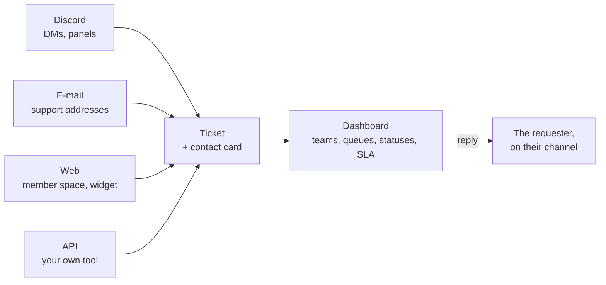
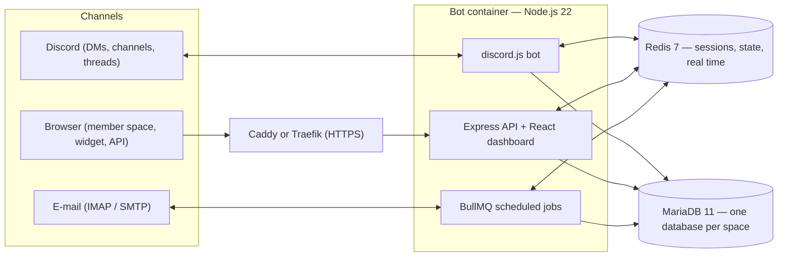

# Overview

Datick is a **complete ticketing system** you host yourself. Requests come in through **Discord**, **e-mail**, a **web form** or the **API**; each one becomes a ticket your team handles from a **real-time web dashboard**. Discord is one channel among others, and it is optional: a space can run on e-mail and the web alone. Every install is independent: you are its only administrator.

## How it works

| Channel | The requester… | They get the replies… |
|---|---|---|
| **Discord** | DMs the bot, or clicks a [panel](./integrations#discord-panels) | by DM, with the ticket in a private channel or thread for the staff (or no channel at all) |
| **E-mail** | writes to a [support address](./integrations#tickets-by-e-mail), each of which can lead to a subject or a team | by e-mail, in the same thread, attachments included |
| **Web** | opens a ticket from the [member space](./member-space) (Discord sign-in or e-mail link) or your site's [widget](./integrations#web-widget) | by e-mail, with a link to follow and reply |
| **API** | — your tool creates, reads and closes tickets through the [public API](./integrations#public-api), and receives webhooks | depending on your integration |

The same person writing on Discord then by e-mail has a single **[contact card](./tickets#contacts)**. On the team side, a ticket follows the same path whatever the channel: subject and category, a [team](./team#teams-and-their-queues)'s queue and automatic assignment, status, deadline, internal notes, [approvals](./tickets#approvals), closing with a transcript and a rating request.

### The Discord journey

1. The member writes to the bot in a **direct message**. If they are on several servers using your bot, they pick one.
2. The bot offers the **FAQ** if their question is in it, then asks for the **subject**, the **fields** and the **form** you configured.
3. A **private channel** (or private thread) is created for the staff; the ticket shows up in the dashboard at once.
4. The staff replies from the dashboard or with `/reply`; the member gets everything by DM, and can also follow their tickets in the [member space](./member-space).
5. When it closes: transcript, a 1 to 5 rating request, and a button to reopen for a few days.

## What it does

| | |
|---|---|
| **Channels** | Discord (DMs, panels, channels, private threads or no channel), e-mail (several addresses, routed by subject or team), web member space, widget, API v1 and v2, webhooks; one contact card per person |
| **Tickets** | Subjects in categories and sub-categories, automatic rules per subject or keywords, custom fields, intake forms, automatic FAQ and public knowledge base, confidential tickets, priorities, stages and custom statuses, approvals, Kanban, deadlines per stage and per category (SLA), merging, linked tickets, transcripts |
| **Dashboard** | My queue, full-text search with operators, saved views, split view, pinned internal notes, reply templates and macros, mentions, following, reminders, time spent, colleagues' presence, drafts, bulk actions |
| **Team** | Grades with fine-grained permissions, teams with their queue and automatic assignment, roles tied to tags, invitations by e-mail or sync with Discord roles, planned absences, goals, statistics, period comparison, reports by team, category and channel (CSV), monthly PDF reports, public statistics in a channel |
| **Requesters** | Replies by DM, by e-mail or on the web, in their language (English, French, Spanish, German, Italian, Portuguese), a web space to follow and open tickets, browsable help, rating, reopening |
| **Instance** | Spaces with or without a Discord server, ways to sign in of your choice (Discord, Google, Microsoft, OpenID Connect, password), Discord servers active as soon as the bot joins, health, errors and alerts, log, encrypted backups checked and copied off the server, one-click updates |
| **Interface** | English and French, light and dark themes, « Pro » or « Classic » interface, accessible (WCAG 2.1 AA), works on a phone |

## Architecture

One instance serves **several spaces** — a Discord server, a brand, a client… —, each with its own database, settings, grades and team: nothing leaks from one space to another. A space can exist without a Discord server.

**Stack**: Node.js 22, discord.js 14, Express 5, MariaDB 11, Redis 7, React 19, Vite, Tailwind CSS 4 — all in Docker containers, with an image published on `ghcr.io/luquypest/datick` (amd64 and arm64).

## Next

- [Try the demo](https://ticket.sunset-fa.fr/demo) — the dashboard on a fictitious server, no account and no install.
- [Install your instance](./installation) — twenty minutes, up to the first ticket.
- [First steps](./first-steps) — what to set right after installing.
