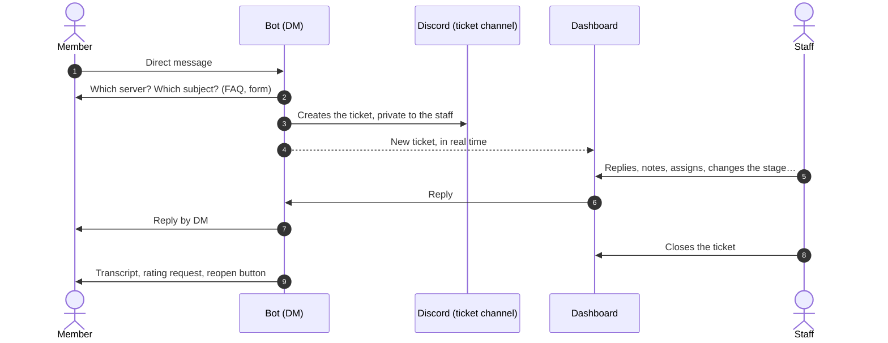
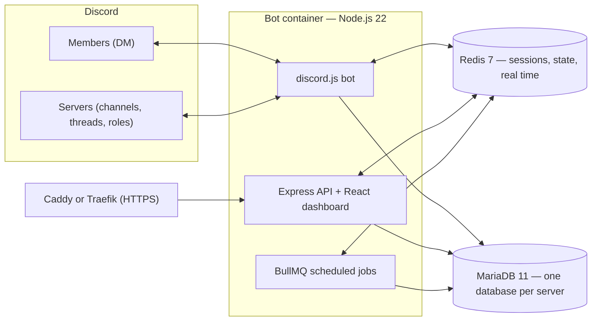

# Overview

Datick turns the **direct messages** sent to your Discord bot into **tickets** that your team handles from Discord or from a **real-time web dashboard**. Every install is independent: you install your instance, plug in your own bot, and you are its only administrator.

## How it works

1. The member writes to the bot in a **direct message**. If they are on several servers using your bot, they pick one.
2. The bot offers the **FAQ** if their question is in it, then asks for the **subject**, the **fields** and the **form** you configured.
3. A **private channel** (or private thread) is created for the staff; the ticket shows up in the dashboard at once.
4. The staff replies from the dashboard or with `/reply`; the member gets everything by DM, and can also follow their tickets in the [member space](./member-space).
5. When it closes: transcript, a 1 to 5 rating request, and a button to reopen for a few days.

## What it does

| | |
|---|---|
| **Tickets** | Subjects and automatic rules per subject or keywords, custom fields, intake forms, automatic FAQ, button panels, confidential tickets, priorities, stages and Kanban, per-stage deadlines (SLA), merging, linked tickets, transcripts |
| **Dashboard** | My queue, full-text search with operators, saved views, split view, pinned internal notes, reply templates and macros, mentions, following, reminders, time spent, colleagues' presence, drafts, bulk actions |
| **Team** | Grades with fine-grained permissions, roles tied to tags, sync with Discord roles, planned absences, goals, statistics, period comparison, monthly PDF reports, public statistics in a channel |
| **Members** | DM replies in their language (English, French, Spanish, German, Italian, Portuguese), a web space to follow and open tickets, browsable help, rating, reopening |
| **Instance** | Owner = owner of the Discord application, servers active as soon as the bot joins, health, errors and alerts, log, encrypted backups checked and copied off the server, one-click updates |
| **Interface** | English and French, light and dark themes, « Pro » or « Classic » interface, accessible (WCAG 2.1 AA), works on a phone |

## Architecture

One bot serves **several Discord servers**, each with its own database, settings, grades and team: nothing leaks from one server to another.

**Stack**: Node.js 22, discord.js 14, Express 5, MariaDB 11, Redis 7, React 19, Vite, Tailwind CSS 4 — all in Docker containers, with an image published on `ghcr.io/luquypest/bot-ticketting` (amd64 and arm64).

## Next

- [Try the demo](https://ticket.sunset-fa.fr/demo) — the dashboard on a fictitious server, no account and no install.
- [Install your instance](./installation) — twenty minutes, from the Discord portal to the first ticket.
- [First steps](./first-steps) — what to set right after installing.
