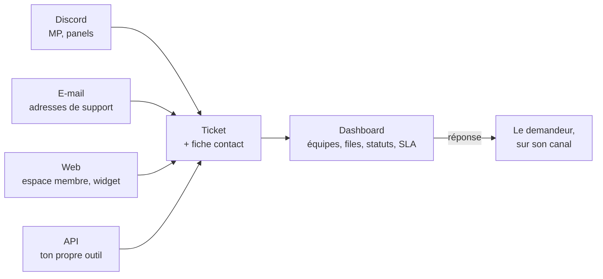
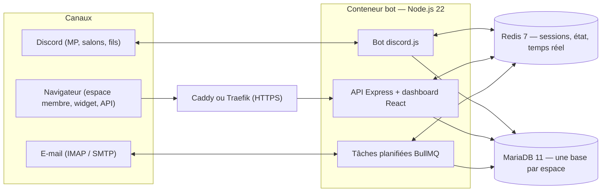

# Présentation

Datick est un **système de tickets complet**, à héberger soi-même. Les demandes arrivent par **Discord**, par **e-mail**, par un **formulaire web** ou par l'**API** ; chacune devient un ticket que ton équipe traite depuis un **dashboard web temps réel**. Discord est un canal parmi d'autres, et il est facultatif : un espace peut fonctionner uniquement par e-mail et par le web. Chaque installation est indépendante : tu en es le seul administrateur.

## Comment ça marche

| Canal | Le demandeur… | Il reçoit les réponses… |
|---|---|---|
| **Discord** | écrit au bot en message privé, ou clique sur un [panel](./integrations#panels-discord) | en MP, avec le ticket dans un salon ou un fil privé côté staff (ou aucun salon) |
| **E-mail** | écrit à une [adresse de support](./integrations#tickets-par-e-mail), chacune pouvant mener à un sujet ou une équipe | par e-mail, dans le même fil, pièces jointes comprises |
| **Web** | ouvre un ticket depuis l'[espace membre](./espace-membre) (connexion Discord ou par lien e-mail) ou le [widget](./integrations#widget-web) de ton site | par e-mail, avec un lien pour suivre et répondre |
| **API** | — ton outil crée, lit et ferme les tickets par l'[API publique](./integrations#api-publique), et reçoit des webhooks | selon ton intégration |

Une même personne qui écrit sur Discord puis par e-mail n'a qu'une **[fiche contact](./tickets#les-contacts)**. Côté équipe, le ticket suit le même chemin quel que soit le canal : sujet et catégorie, file d'une [équipe](./equipe#les-equipes-et-leurs-files) et attribution automatique, statut, délai, notes internes, [validations](./tickets#les-validations), fermeture avec transcript et demande de note.

### Le parcours sur Discord

1. Le membre écrit au bot en **message privé**. S'il est sur plusieurs serveurs qui utilisent ton bot, il choisit lequel.
2. Le bot lui propose la **FAQ** si sa question y figure, puis lui demande le **sujet**, les **champs** et le **formulaire** que tu as configurés.
3. Un **salon privé** (ou un fil privé) est créé côté staff ; le ticket apparaît aussitôt dans le dashboard.
4. Le staff répond depuis le dashboard ou par `/reply` ; le membre reçoit tout en MP, et peut aussi suivre ses tickets sur l'[espace membre](./espace-membre).
5. À la fermeture : transcript, demande de note de 1 à 5, bouton pour rouvrir pendant quelques jours.

## Ce qu'il sait faire

| | |
|---|---|
| **Canaux** | Discord (MP, panels, salons, fils privés ou aucun salon), e-mail (plusieurs adresses, routage par sujet ou équipe), espace membre web, widget, API v1 et v2, webhooks ; fiche contact unique par personne |
| **Tickets** | Sujets en catégories et sous-catégories, règles automatiques (quand, si, alors : ouverture, réponses, statut, priorité ; conditions et actions en ordre, test, journal), champs personnalisés, formulaires d'ouverture, FAQ automatique et base de connaissances publique, tickets confidentiels, priorités, étapes et statuts personnalisés, validations, Kanban, délais par étape et par catégorie (SLA), fusion, tickets liés, transcripts |
| **Dashboard** | Ma file, recherche plein texte avec opérateurs, vues enregistrées, vue fractionnée, notes internes épinglées, modèles de réponse et macros, mentions, suivi, rappels, temps passé, présence des collègues, brouillons, actions en masse |
| **Équipe** | Grades aux permissions fines, équipes avec leur file et attribution automatique, rôles rattachés à des tags, invitations par e-mail ou synchronisation avec les rôles Discord, absences planifiées, objectifs, statistiques, comparaison de périodes, rapports par équipe, catégorie et canal (CSV), rapports PDF mensuels, statistiques publiques dans un salon |
| **Demandeurs** | Réponses en MP, par e-mail ou sur le web, dans leur langue (français, anglais, espagnol, allemand, italien, portugais), espace web pour suivre et ouvrir des tickets, aide consultable, notation, réouverture |
| **Instance** | Espaces avec ou sans serveur Discord, moyens de connexion au choix (Discord, Google, Microsoft, OpenID Connect, annuaire LDAP / Active Directory, mot de passe), serveurs Discord actifs dès l'arrivée du bot, santé, erreurs et alertes, journal, sauvegardes chiffrées vérifiées et copiées hors du serveur, mises à jour en un clic |
| **Interface** | Français et anglais, thème clair et sombre, interface « Pro » par défaut ou « Classique » (Profil → Affichage), accessible (WCAG 2.1 AA), adaptée au téléphone |

## Architecture

Une instance sert **plusieurs espaces** — un serveur Discord, une marque, un client… —, chacun avec sa propre base de données, ses réglages, ses grades et son équipe : rien ne déborde d'un espace à l'autre. Un espace peut exister sans serveur Discord.

**Stack** : Node.js 22, discord.js 14, Express 5, MariaDB 11, Redis 7, React 19, Vite, Tailwind CSS 4 — le tout en conteneurs Docker, avec une image publiée sur `ghcr.io/luquypest/datick` (amd64 et arm64).

## Et ensuite

- [Essayer la démo](https://ticket.sunset-fa.fr/demo) — le dashboard sur un serveur fictif, sans compte ni installation.
- [Installer ton instance](./installation) — vingt minutes, jusqu'au premier ticket.
- [Premiers pas](./premiers-pas) — ce qu'il faut régler juste après l'installation.
