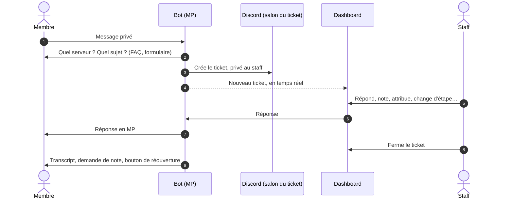
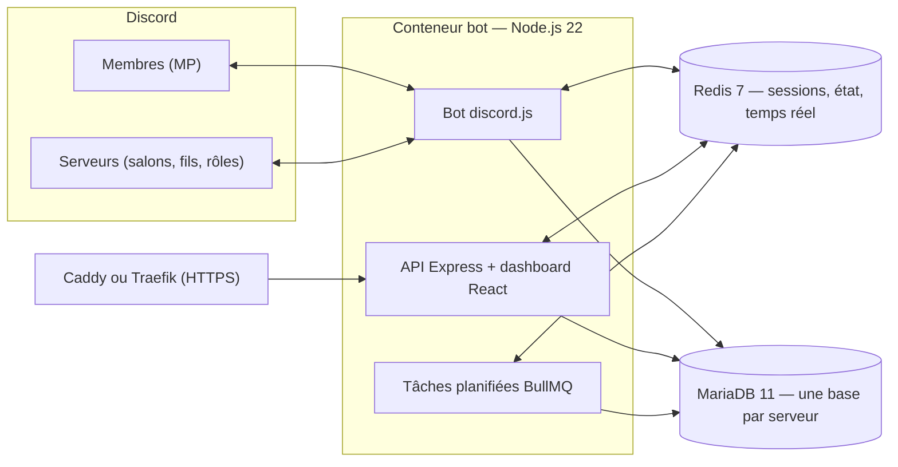

# Présentation

Ticket Bot transforme les **messages privés** envoyés à ton bot Discord en **tickets** que ton équipe traite depuis Discord ou depuis un **dashboard web temps réel**. Chaque installation est indépendante : tu installes ton instance, tu y branches ton propre bot, et tu en es le seul administrateur.

## Comment ça marche

1. Le membre écrit au bot en **message privé**. S'il est sur plusieurs serveurs qui utilisent ton bot, il choisit lequel.
2. Le bot lui propose la **FAQ** si sa question y figure, puis lui demande le **sujet**, les **champs** et le **formulaire** que tu as configurés.
3. Un **salon privé** (ou un fil privé) est créé côté staff ; le ticket apparaît aussitôt dans le dashboard.
4. Le staff répond depuis le dashboard ou par `/reply` ; le membre reçoit tout en MP, et peut aussi suivre ses tickets sur l'[espace membre](./espace-membre).
5. À la fermeture : transcript, demande de note de 1 à 5, bouton pour rouvrir pendant quelques jours.

## Ce qu'il sait faire

| | |
|---|---|
| **Tickets** | Sujets et règles automatiques par sujet ou mots-clés, champs personnalisés, formulaires d'ouverture, FAQ automatique, panels à boutons, tickets confidentiels, priorités, étapes et Kanban, délais par étape (SLA), fusion, tickets liés, transcripts |
| **Dashboard** | Ma file, recherche plein texte avec opérateurs, vues enregistrées, vue fractionnée, notes internes épinglées, modèles de réponse et macros, mentions, suivi, rappels, temps passé, présence des collègues, brouillons, actions en masse |
| **Équipe** | Grades aux permissions fines, rôles rattachés à des tags, synchronisation avec les rôles Discord, absences planifiées, objectifs, statistiques, comparaison de périodes, rapports PDF mensuels |
| **Membres** | Réponses en MP dans leur langue, espace web pour suivre et ouvrir des tickets, aide consultable, notation, réouverture |
| **Instance** | Propriétaire = propriétaire de l'application Discord, serveurs actifs dès l'arrivée du bot, santé, erreurs et alertes, journal, sauvegardes chiffrées |
| **Interface** | Français et anglais, thème clair et sombre, interface « Pro » ou « Classique », accessible (WCAG 2.1 AA), adaptée au téléphone |

## Architecture

Un même bot sert **plusieurs serveurs Discord**, chacun avec sa propre base de données, ses réglages, ses grades et son équipe : rien ne déborde d'un serveur à l'autre.

**Stack** : Node.js 22, discord.js 14, Express 5, MariaDB 11, Redis 7, React 19, Vite, Tailwind CSS 4 — le tout en conteneurs Docker, avec une image publiée sur `ghcr.io/luquypest/bot-ticketting` (amd64 et arm64).

## Et ensuite

- [Installer ton instance](./installation) — vingt minutes, du portail Discord au premier ticket.
- [Premiers pas](./premiers-pas) — ce qu'il faut régler juste après l'installation.
